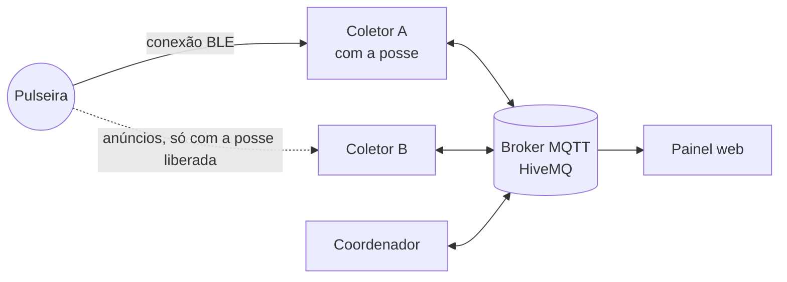

# CNPEM · Projeto 13 · Frente 3
**Sistema de Monitoramento Cardíaco e Detecção de Estresse para o NB4: rede distribuída de coletores BLE**

Gateway que mantém um fluxo contínuo de frequência cardíaca enquanto o pesquisador se desloca pelo laboratório. Coletores (Raspberry Pi) leem o RSSI e a frequência cardíaca de pulseiras Polar Verity Sense e publicam num *broker* MQTT. Um coordenador decide qual coletor tem a posse de cada pulseira e conduz o *handoff*, e um painel web exibe os dados em tempo real.

A frequência cardíaca é lida pelo *Heart Rate Service* padrão do Bluetooth SIG, então qualquer pulseira compatível serve.

---

## Sumário
- [Como funciona](#como-funciona)
- [Tecnologias](#tecnologias)
- [Estrutura de pastas](#estrutura-de-pastas)
- [Configuração](#configuração)
- [Como rodar](#como-rodar)
- [Testes](#testes)
- [Documentação](#documentação)
- [Licença](#licença)

---

## Como funciona



| Componente | Onde roda | O que faz |
|---|---|---|
| Coletor (`PAPEL=coletor`) | Raspberry Pi com Linux e BlueZ, um por máquina | Com a posse liberada, escuta os anúncios da pulseira e publica a mediana do RSSI. Com a posse, conecta, recebe a frequência cardíaca, lê o RSSI da conexão e publica tudo no *broker* |
| Coordenador (`PAPEL=coordenador`) | Máquina central | Acompanha os coletores pelo *broker*, concede a posse por disputa, libera a posse órfã e inicia o *handoff* |
| Painel (`PAPEL=painel`) | Máquina central | Página web na porta 8765 com frequência cardíaca, RSSI, estado e histórico de 15 min de cada pulseira |
| *Broker* | Máquina central (HiveMQ CE) | Único ponto de integração. Guarda a presença e a posse em mensagens retidas |

Toda a coordenação passa pelo *broker*: não há conexão direta entre as máquinas. A pulseira aceita uma conexão por vez e não anuncia enquanto está conectada, por isso o *handoff* é do tipo "soltar e disputar":

1. O coordenador classifica o coletor ativo como `conexao-fraca` (RSSI abaixo de −78 dBm em 3 leituras seguidas) e publica o comando de *handoff*.
2. A origem desconecta, publica a liberação da posse e volta a varrer.
3. Durante a janela de disputa (3 s), os coletores que enxergam a pulseira publicam o RSSI dos anúncios. A origem é a favorita e só perde para quem a superar em 5 dB.
4. O vencedor recebe a posse e conecta. Se não conectar em 5 s, a posse volta à origem.

Os valores acima são os padrões e podem ser mudados no `.env`. Os tópicos e o formato das mensagens estão no [RF15](docs/RFs/RF15.md).

---

## Tecnologias

| Tecnologia | Versão | Uso |
|---|---|---|
| Python | 3.11 (imagem Docker) | Todo o código, com `asyncio` |
| [bleak](https://bleak.readthedocs.io/) | 1.1.1 | BLE: varredura, conexão GATT e notificações, via BlueZ/D-Bus |
| `btmgmt` (BlueZ) | da distribuição | RSSI da conexão ativa |
| [aiomqtt](https://github.com/empicano/aiomqtt) | 2.5.1 | Cliente MQTT |
| python-dotenv | 1.1.1 | Leitura do `.env` |
| HiveMQ CE | 2026.5 | *Broker* MQTT |
| Docker Engine e Docker Compose | — | Implantação, com os *profiles* `central` e `coletor` |
| pytest | 9.2.0 | Testes automatizados (só desenvolvimento) |

As dependências ficam fixadas em `requirements.txt` (produção, entra na imagem) e `requirements-dev.txt` (acrescenta o pytest).

---

## Estrutura de pastas

```text
cnpem-projeto13-frente3/
├── docker-compose.yml      # hivemq, coordenador e painel (profile central); coletor (profile coletor)
├── Dockerfile              # Imagem única (Python 3.11 + BlueZ) do coletor, do coordenador e do painel
├── .env.example            # Todas as variáveis, com os padrões e comentários
├── requirements.txt        # Dependências de produção
├── requirements-dev.txt    # Produção + pytest
├── start.sh                # Instala o Docker Engine no Ubuntu
├── docs/                   # Requisitos, linguagem ubíqua e roteiro de execução
├── tests/                  # Testes automatizados, sem hardware
└── src/gateway/            # Raiz dos imports
    ├── app.py              # Entrada de produção: escolhe o papel pela variável PAPEL
    ├── main.py             # Diagnóstico com hardware: um teste_rfXX() por RF
    ├── bluetooth/          # Varredura, conexão GATT, RSSI e reconexão (único módulo que importa o bleak)
    │   └── domain/         # Modelos, erros e interpretação da frequência cardíaca, sem I/O
    ├── mqtt/               # Conexão com o broker, presença, estado/RSSI e publicação da frequência cardíaca
    │   └── domain/         # Envelope das mensagens, QoS e retenção por tipo, tópicos
    ├── coletor/            # Orquestração do coletor e vigia do coordenador
    ├── coordenador/        # Visão da rede, disputa, conexao-fraca e handoff
    └── painel/             # Servidor HTTP/SSE, página (static/) e simulador
        └── domain/         # Visão do painel e faixas de sinal
```

---

## Configuração

```bash
cp .env.example .env
```

O repositório e o `docker-compose.yml` são os mesmos em todas as máquinas. Muda só o `.env`:

| Variável | Central | Coletor |
|---|---|---|
| `COMPOSE_PROFILES` | `central` | `coletor` |
| `BROKER_HOST` | (o compose usa `hivemq`) | IP da central |
| `TARGET_ADDRESS` | MAC da pulseira | MAC da pulseira |
| `PULSEIRAS` | MACs das pulseiras acompanhadas, separados por vírgula | não usa |
| `COORDENADOR_ID` | igual em todas | igual em todas |
| `PRAZO_CONEXAO` | igual em todas | igual em todas |

- O id do coletor é o hostname da máquina, que precisa ser único na rede: `sudo hostnamectl set-hostname coletor-sala-1`. `COLETOR_ID` vence o hostname.
- Os demais parâmetros (prazos, limiar de `conexao-fraca`, janela de disputa, margem, reconexão) estão no `.env.example` com os padrões dos RFs. Mudar um valor exige só recriar o container, sem *rebuild*.
- `LOG_LEVEL=DEBUG` mostra cada sinal recebido pelo coordenador e os sinais de vida.
- `BROKER_SENHA` nunca vai para o repositório.

---

## Como rodar

Os coletores precisam de **Linux com BlueZ**. A preparação das máquinas (Bluetooth, permissão do `btmgmt`, Docker, hostname, relógios sincronizados e portas da rede) está na [seção 2 do `docs/execucao.md`](docs/execucao.md#2-preparar-as-máquinas).

### Com Docker Compose

```bash
# Máquina central (.env: COMPOSE_PROFILES=central)
docker compose up -d --build

# Cada coletor (.env: COMPOSE_PROFILES=coletor e BROKER_HOST=<IP da central>)
docker compose up -d --build

# Tudo numa máquina só (.env: COMPOSE_PROFILES=central,coletor e BROKER_HOST=localhost)
docker compose up -d --build
```

- Painel: `http://<IP da central>:8765`, de qualquer computador da rede.
- Logs: `docker compose logs -f --timestamps coordenador` (ou `coletor`, `painel`).
- O container do coletor usa a rede do host, roda em modo privilegiado e compartilha o *socket* D-Bus do host, onde está o BlueZ.
- O código (`src/`) é montado como volume: depois de mudar o código, basta `docker compose restart`.

### Nativo (sem Docker)

```bash
python3 -m venv .venv
source .venv/bin/activate
pip install -r requirements.txt
sudo setcap cap_net_admin+eip "$(command -v btmgmt)"   # RSSI da conexão sem root (RF04)

docker compose up -d hivemq                              # o broker continua no Docker

# Um terminal para cada papel
PAPEL=coordenador BROKER_HOST=localhost python src/gateway/app.py
PAPEL=painel      BROKER_HOST=localhost python src/gateway/app.py
PAPEL=coletor     BROKER_HOST=localhost python src/gateway/app.py
```

Sem a permissão do `btmgmt`, o coletor conecta e recebe a frequência cardíaca, mas o RSSI sai como `rssi-indisponivel`, e o *handoff* nunca acontece.

### Painel em modo simulado

Dois coletores e um coordenador falsos publicam uma pulseira simulada, com *handoff*, queda e trecho sem frequência cardíaca. Não rode junto com o coordenador real.

```bash
docker compose up -d hivemq
PAINEL_SIMULADO=1 PAPEL=painel BROKER_HOST=localhost python src/gateway/app.py
# abra http://localhost:8765
```

### macOS

No macOS, o bleak usa o CoreBluetooth, que identifica a pulseira por UUID em vez de MAC, e o `btmgmt` não existe. O Docker Desktop também não tem acesso ao Bluetooth. Por isso o coletor só roda em Linux. No macOS dá para rodar os testes automatizados, o coordenador e o painel.

---

## Testes

### Automatizados (sem hardware)

```bash
pip install -r requirements-dev.txt
python -m pytest tests -q
```

São 179 testes, que rodam em menos de 10 s sem pulseira, sem Bluetooth e sem *broker*: dublês fazem o papel do bleak e do aiomqtt, e relógios falsos verificam os prazos sem esperar. Cada arquivo também roda sozinho, sem o pytest: `python tests/test_coordenador.py`.

| Arquivo | Testes | Requisitos |
|---|---|---|
| `test_reconexao.py` | 13 | RF05, RF04 |
| `test_rssi.py` | 15 | RF04 |
| `test_varredura.py` | 18 | RF18, RF09, RF14 |
| `test_estado_conexao.py` | 4 | RF08 |
| `test_desconexao.py` | 5 | RF10, RF05, RF12 |
| `test_mensagens.py` | 16 | RF15, RF12 |
| `test_broker.py` | 17 | RF11, RF14, RF19 |
| `test_frequencia_cardiaca.py` | 15 | RF17 |
| `test_coordenador.py` | 54 | RF06, RF13, RF14, RF19 |
| `test_painel.py` | 22 | RF20 |

### Diagnóstico com hardware (`main.py`)

O `main.py` tem um `teste_rfXX()` por RF, que registra cada critério de aceitação como `[OK]` ou `[FALHA]`. Descomente **um** teste no `main()` e rode:

```bash
python src/gateway/main.py
```

Ou, sem editar o arquivo:

```bash
PYTHONPATH=src/gateway python -c "import asyncio, main; asyncio.run(main.teste_rf01())"
```

O `main.py` usa o hostname como client id: não rode junto com o coletor da mesma máquina, ou use `COLETOR_ID=diag-$(uname -n)` na frente do comando. A ordem dos testes e o que observar em cada um estão na [seção 4 do `docs/execucao.md`](docs/execucao.md#4-nível-2-diagnóstico-com-hardware-mainpy).

### Roteiro completo

O [`docs/execucao.md`](docs/execucao.md) organiza os testes em cinco níveis, do mais barato ao mais caro:

| Nível | O que testa | Precisa de |
|---|---|---|
| 1. Testes automatizados | Regras, ordem das mensagens e prazos | Nada |
| 2. Diagnóstico por RF | Cada RF isolado, com a pulseira (`main.py`) | 1 máquina com Bluetooth, 1 pulseira, *broker* |
| 3. Sistema com 1 coletor | Posse, quedas, reinícios e painel | Central + 1 coletor (pode ser a mesma máquina) |
| 4. Disputa e *handoff* | Disputa, favorito, pulseira órfã e *handoff* | Central + 2 coletores em máquinas diferentes |
| 5. Campo | Percurso real, calibração e metas do RNF04 | Central + coletores instalados no laboratório |

---

## Documentação

- [`docs/execucao.md`](docs/execucao.md): preparar as máquinas, rodar e testar cada fluxo.
- [`docs/RFs/`](docs/RFs/): RF01 a RF20, com caso de uso, história de usuário e critérios de aceitação.
- [`docs/RNFs/`](docs/RNFs/): RNF01 a RNF12, com metas.
- [`docs/Linguagem-Ubiqua.md`](docs/Linguagem-Ubiqua.md): vocabulário usado nos requisitos, no código e nas mensagens.
- [`docs/BLE_linux.md`](docs/BLE_linux.md): como o bleak chega ao Bluetooth no Linux (BlueZ e D-Bus).
- [`docs/Projeto13.pdf`](docs/Projeto13.pdf): proposta do projeto e das três frentes.

---

## Licença

[MIT](LICENSE).
