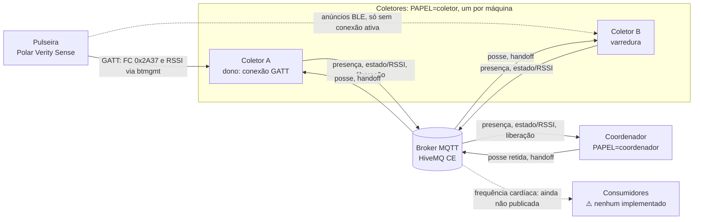
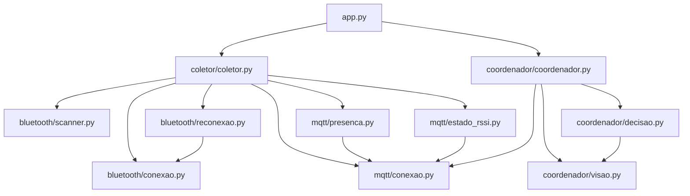
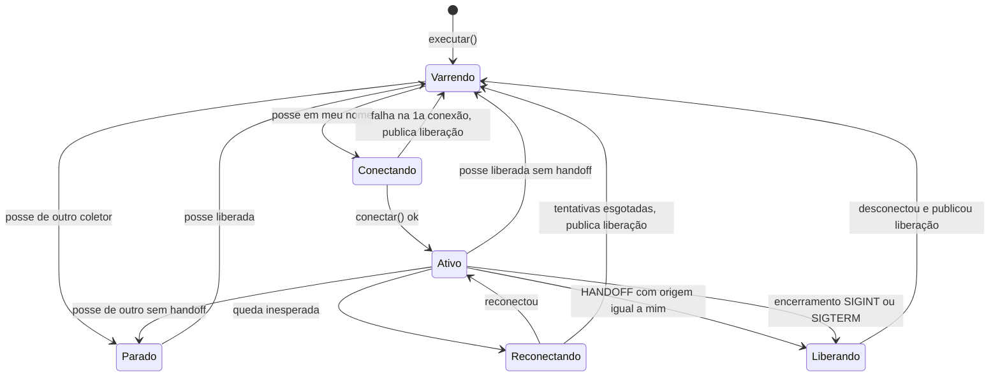
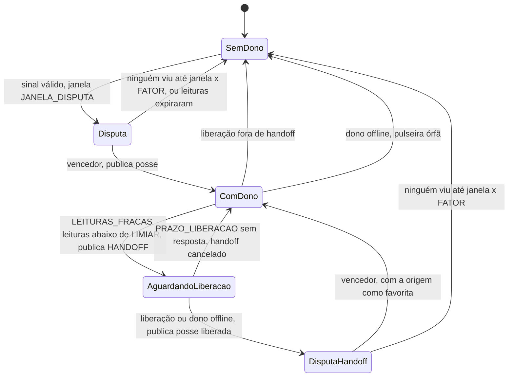
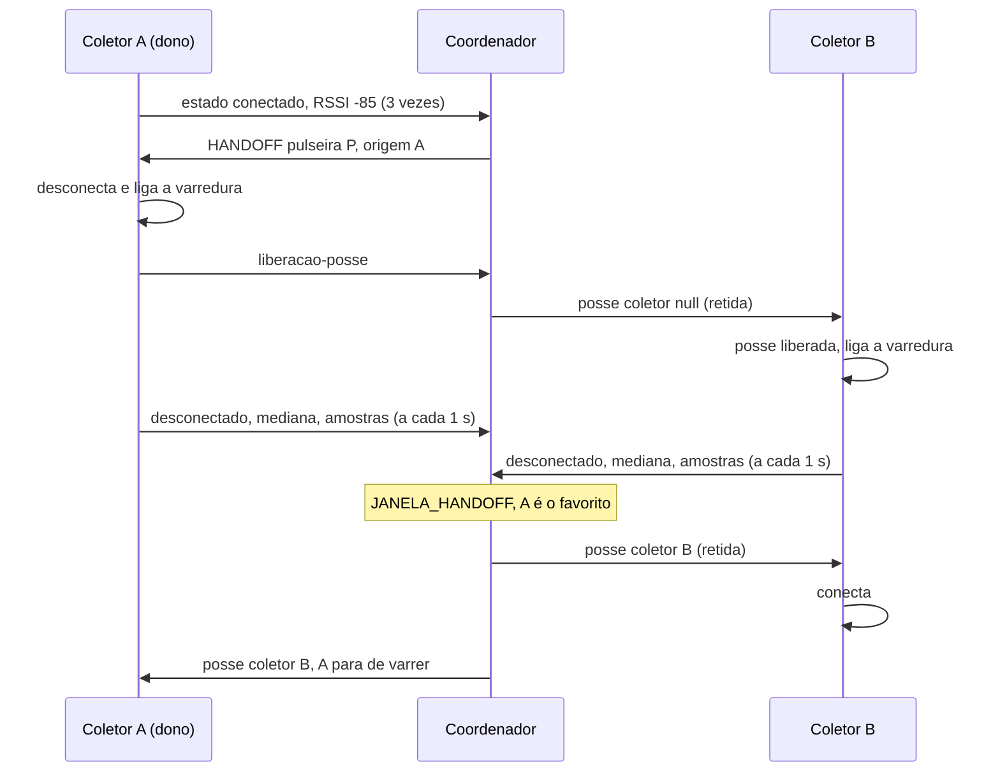

# Manual do desenvolvedor: gateway BLE (CNPEM Projeto 13, Frente 3)

Para ler com o código aberto ao lado. Os caminhos são relativos à raiz do repositório, e os números de linha foram conferidos no commit `4801a51` (branch `develop`). Se o código mudar, procure pelo nome da função.

Os requisitos estão em `docs/RFs/` e `docs/RNFs/`, e o vocabulário do projeto em `docs/Linguagem-Ubiqua.md`. Este manual descreve **o que o código faz hoje**. Onde o código está incompleto ou ambíguo, aparece a marca **⚠️ A confirmar**. A lista completa dessas marcas está na seção 10.

---

## 1. Visão geral

O mesmo programa (`src/gateway/app.py`) roda em dois papéis, escolhidos pela variável `PAPEL`:

- **Coletor:** um por máquina com rádio Bluetooth, tipicamente um Raspberry Pi. Varre os anúncios BLE de uma pulseira Polar Verity Sense e publica no broker MQTT o RSSI medido.
- **Coordenador:** um só, sem Bluetooth. Lê esses RSSI e decide qual coletor tem a **posse** da pulseira.

Só o dono da posse se conecta à pulseira (GATT), lê a frequência cardíaca e o RSSI da conexão. Quando o RSSI da conexão fica fraco, o coordenador manda o dono soltar a pulseira. Ela volta a anunciar, e os coletores que a enxergam disputam a posse de novo. Toda a coordenação passa pelo broker: não existe ligação direta entre os coletores.



### Diferenças em relação ao documento de design

O PDF `docs/Ponte BLE–TCP IP com handoff entre dois PCs (Polar Verity Sense).pdf` descreve uma versão anterior da arquitetura. Hoje:

| No PDF | No código |
| :--- | :--- |
| Link TCP entre os nós (heartbeat, troca de RSSI, controle de handoff) | Não existe. Tudo passa pelo broker MQTT, e quem decide é o coordenador (`src/gateway/coordenador/coordenador.py:42`) |
| Máquina de estados `IDLE → SCANNING → CONNECTING → ACTIVE → RELEASING` | Não há enum de estados. O estado do coletor é implícito, e a seção 5 mostra como mapeá-lo |
| Handoff *make-before-break* ou `STANDBY` com dupla conexão | Handoff "soltar e disputar": o dono desconecta antes de qualquer outro conectar |
| Saída dos dados fisiológicos em MQTT | ⚠️ A confirmar: a frequência cardíaca é lida, mas **não é publicada** (seção 4, etapa 8) |

### 1.1 Mapa dos módulos

| Módulo | Responsabilidade | Chamado por |
| :--- | :--- | :--- |
| `src/gateway/app.py` | Ponto de entrada: lê `PAPEL` e roda o coletor ou o coordenador | linha de comando, Docker |
| `src/gateway/main.py` | Roteiro de diagnósticos manuais (`teste_rf03` … `teste_rf09`) contra hardware e broker reais | linha de comando |
| `src/gateway/coletor/coletor.py` | Orquestra o coletor: reage à posse e ao handoff, liga e desliga a varredura e a sessão BLE | `app.py` |
| `src/gateway/bluetooth/scanner.py` | Varredura BLE e agregação do RSSI dos anúncios (mediana por intervalo) | `coletor.py`, `main.py` |
| `src/gateway/bluetooth/conexao.py` | Conexão GATT, notificações de FC, RSSI da conexão via `btmgmt` | `coletor.py`, `reconexao.py`, `main.py` |
| `src/gateway/bluetooth/reconexao.py` | Laço de conectar, reconectar e reiniciar os fluxos a cada conexão (RF05) | `coletor.py`, testes |
| `src/gateway/bluetooth/domain/models.py` | Dataclasses (`LeituraRSSI`, `Pulseira` etc.) e `EstadoConexao` | todos |
| `src/gateway/bluetooth/domain/erros.py` | Hierarquia de erros, cada um com um `codigo` usado nos logs | todos |
| `src/gateway/mqtt/conexao.py` | Sessão MQTT com reconexão, reassinatura e ganchos de conexão | coletor, coordenador |
| `src/gateway/mqtt/presenca.py` | Presença, sinal de vida e Last Will do coletor | `coletor.py` |
| `src/gateway/mqtt/estado_rssi.py` | Fila e publicação de estado e RSSI | `coletor.py` |
| `src/gateway/mqtt/domain/models.py` | Envelope `Mensagem`, tipos, QoS e retenção por tipo | todos os módulos MQTT |
| `src/gateway/mqtt/domain/topicos.py` | Montagem e leitura de tópicos | todos os módulos MQTT |
| `src/gateway/coordenador/coordenador.py` | Posse, disputa, handoff, pulseira órfã | `app.py` |
| `src/gateway/coordenador/visao.py` | O que o coordenador sabe da rede: presença, sinais, posse | `coordenador.py`, `decisao.py` |
| `src/gateway/coordenador/decisao.py` | Regra de escolha do vencedor (histerese, mínimo de amostras) | `coordenador.py` |
| `tests/test_reconexao.py` | Testes automatizados do laço de reconexão, sem hardware | linha de comando |



Os módulos `domain/` foram omitidos do grafo porque quase todos os outros dependem deles.

---

## 2. Glossário

Só termos que aparecem no código. Os termos de negócio estão em `docs/Linguagem-Ubiqua.md`.

| Termo | O que é | Onde aparece |
| :--- | :--- | :--- |
| BLE | Bluetooth Low Energy. Um *periférico* (a pulseira) anuncia, e um *central* (o coletor) varre e se conecta | `src/gateway/bluetooth/` |
| Anúncio (*advertising*) | Pacote curto que o periférico transmite periodicamente para ser descoberto. Cada anúncio recebido traz um RSSI | `src/gateway/bluetooth/scanner.py:73` |
| Varredura (*scan*) | Escutar anúncios sem se conectar | `src/gateway/bluetooth/scanner.py:98` |
| GATT | Protocolo de dados de uma conexão BLE. O periférico expõe **serviços**, e cada serviço tem **características** | `src/gateway/bluetooth/conexao.py:29` |
| Característica (*characteristic*) | Valor dentro de um serviço, que pode ser lido, escrito ou **notificado**. A FC é a `0x2A37` (Heart Rate Measurement) do serviço `0x180D` | `src/gateway/bluetooth/conexao.py:23` |
| Notificação | O periférico envia o valor ao central sempre que ele muda, depois de o central assiná-lo (`start_notify`) | `src/gateway/bluetooth/conexao.py:215` |
| RSSI | Intensidade do sinal recebido, em dBm. É negativo: -60 é melhor que -80. O código usa dois RSSI: o **do anúncio** (varredura) e o **da conexão** (`btmgmt`) | `src/gateway/bluetooth/scanner.py:117`, `src/gateway/bluetooth/conexao.py:235` |
| PMD | *Polar Measurement Data*, serviço proprietário da Polar para fluxos como PPG e acelerômetro, que precisam de um comando de início a cada conexão. **Só é citado em comentário**, não está implementado | `src/gateway/bluetooth/reconexao.py:132` |
| Handoff | Troca do coletor ativo: o dono solta e os coletores disputam. A origem pode vencer e reconectar | `src/gateway/coordenador/coordenador.py:199` |
| Histerese (margem) | O favorito só perde para quem for melhor por `MARGEM_HISTERESE` dB. Isso evita trocas de ida e volta (*ping-pong*) | `src/gateway/coordenador/decisao.py:3`, `src/gateway/coordenador/decisao.py:19` |
| Posse | Responsabilidade de **um único** coletor sobre a pulseira. Só o coordenador a publica | `src/gateway/coordenador/coordenador.py:407` |
| Disputa | Janela em que o coordenador junta o RSSI dos coletores e concede a posse ao melhor | `src/gateway/coordenador/coordenador.py:370` |
| Favorito | Último coletor que publicou `conectado` para a pulseira | `src/gateway/coordenador/coordenador.py:168` |
| Pulseira órfã | Pulseira cuja posse está com um coletor offline. O coordenador libera a posse | `src/gateway/coordenador/coordenador.py:132` |
| Tópico MQTT | "Endereço" hierárquico de uma mensagem, com níveis separados por `/`. Na assinatura, `+` casa um nível e `#` casa o resto | `src/gateway/mqtt/domain/topicos.py` |
| QoS | Nível de entrega do MQTT: 0 entrega no máximo uma vez, 1 entrega pelo menos uma vez | `src/gateway/mqtt/domain/models.py:25` |
| Mensagem retida | O broker guarda a última mensagem do tópico e a entrega a quem assinar depois | `src/gateway/mqtt/domain/models.py:26` |
| Last Will | Mensagem que o broker publica em nome de um cliente que caiu sem avisar | `src/gateway/mqtt/presenca.py:137` |

Dois termos pedidos para este glossário não aparecem no código: *make-before-break*, porque o handoff aqui é o oposto (soltar antes, conectar depois), e *bring-up*.

---

## 3. Setup e execução

### 3.1 Dependências

| Item | Versão ou origem | Para quê |
| :--- | :--- | :--- |
| Python | 3.11 ou mais nova. O código usa `match` e `statistics.fmean(weights=)`, que só existe a partir da 3.11. A imagem Docker usa 3.11 (`Dockerfile:1`) | tudo |
| `bleak` | 1.1.1 (`requirements.txt:1`) | BLE |
| `aiomqtt` | 2.5.1 (`requirements.txt:3`) | MQTT |
| `python-dotenv` | 1.1.1 (`requirements.txt:2`) | lê o `.env` |
| BlueZ e D-Bus | pacotes `bluez` e `dbus` (`Dockerfile:9-13`) | pilha Bluetooth no Linux, e o `btmgmt` para o RSSI da conexão |
| Docker e Compose | `start.sh` instala no Ubuntu | broker e implantação |
| Broker | `hivemq/hivemq-ce:2026.5` (`docker-compose.yml:9`) | MQTT |

### 3.2 Sistemas operacionais

| | Linux (BlueZ) | macOS | Windows |
| :--- | :--- | :--- | :--- |
| Identificador da pulseira | MAC (`A0:9E:1A:…`) | UUID por máquina, não é o MAC | ⚠️ A confirmar |
| Varredura e RSSI do anúncio | sim | sim | ⚠️ A confirmar: não testado |
| RSSI da conexão (`btmgmt`) | sim, com permissão (seção 9.3) | **não**: `btmgmt` não existe | **não** |
| `app.py` (coletor ou coordenador) | sim | sim, mas sem RSSI de conexão não há conexão fraca, favorito nem handoff automático | **não sobe**: `loop.add_signal_handler` (`src/gateway/app.py:54-55`) só existe em Unix |
| BLE dentro do Docker | sim, com `network_mode: host`, `privileged` e o socket do D-Bus (`docker-compose.yml:35-39`) | não: o Docker Desktop não repassa o Bluetooth | não |

O alvo de produção é Raspberry Pi com Linux (RNF01) em container (RNF02).

**Por que o RSSI da conexão depende do SO:** o BlueZ não expõe pelo D-Bus o RSSI de uma conexão ativa, e o `bleak` só entrega o RSSI dos anúncios. Por isso `ConexaoPulseira.ler_rssi` chama o `btmgmt conn-info` como subprocesso (`src/gateway/bluetooth/conexao.py:247-251`). Fora do Linux, a primeira leitura falha e o monitor de RSSI para (`src/gateway/bluetooth/conexao.py:293-295`).

### 3.3 Variáveis de configuração

O `.env` da raiz é carregado por `load_dotenv()` (`src/gateway/app.py:23`). Uma variável já definida no ambiente tem precedência sobre o `.env`. No Docker, o compose injeta o `.env` com `env_file` (`docker-compose.yml:4`).

| Variável | Padrão | Papel | Lida em |
| :--- | :--- | :--- | :--- |
| `PAPEL` | obrigatória: `coletor` ou `coordenador` | ambos | `src/gateway/app.py:63` |
| `LOG_LEVEL` | `INFO` | ambos | `src/gateway/app.py:15` |
| `TARGET_ADDRESS` | obrigatória no coletor | coletor | `src/gateway/app.py:27` |
| `COLETOR_ID` | hostname da máquina | coletor | `src/gateway/coletor/coletor.py:25` |
| `COORDENADOR_ID` | `coordenador` | coordenador | `src/gateway/app.py:37` |
| `BROKER_HOST` / `BROKER_PORTA` | `localhost` / `1883` | ambos | `src/gateway/mqtt/conexao.py:52-53` |
| `BROKER_USUARIO` / `BROKER_SENHA` | vazias | ambos | `src/gateway/mqtt/conexao.py:54-55` |
| `BROKER_INTERVALO_RECONEXAO` | 5 s | ambos | `src/gateway/mqtt/conexao.py:56-58` |
| `PRESENCA_INTERVALO_COLETOR` | 5 s | coletor | `src/gateway/mqtt/presenca.py:24` |
| `PRESENCA_INTERVALO_COORDENADOR` | 5 s | coordenador | `src/gateway/coordenador/coordenador.py:35` |
| `ESTADO_RSSI_TAMANHO_FILA` | 100 | coletor | `src/gateway/mqtt/estado_rssi.py:25` |
| `RSSI_INTERVALO` | 1 s | coletor | `src/gateway/bluetooth/scanner.py:104` (varredura) **e** `src/gateway/bluetooth/conexao.py:282` (conexão) |
| `VARREDURA_TEMPO_AUSENCIA` | 5 s | coletor | `src/gateway/bluetooth/scanner.py:105` |
| `CONNECT_TIMEOUT` | 20 s | coletor | `src/gateway/bluetooth/conexao.py:41` |
| `RECONEXAO_MAX_TENTATIVAS` / `RECONEXAO_INTERVALO` | 5 / 3 s | coletor | `src/gateway/bluetooth/reconexao.py:30-32` |
| `SCAN_TIMEOUT` | 10 s | só os diagnósticos do `main.py` | `src/gateway/bluetooth/scanner.py:47` |
| `JANELA_DISPUTA` | 5 s | coordenador | `src/gateway/coordenador/coordenador.py:64` |
| `JANELA_HANDOFF` | 3 s | coordenador | `src/gateway/coordenador/coordenador.py:65` |
| `FATOR_EXTENSAO_JANELA` | 3 | coordenador | `src/gateway/coordenador/coordenador.py:71` |
| `LIMIAR_CONEXAO_FRACA` | -78 dBm | coordenador | `src/gateway/coordenador/coordenador.py:66` |
| `LEITURAS_FRACAS` | 3 | coordenador | `src/gateway/coordenador/coordenador.py:67` |
| `PRAZO_LIBERACAO` | 3 s | coordenador | `src/gateway/coordenador/coordenador.py:68` |
| `MARGEM_HISTERESE` | 5 dB | coordenador | `src/gateway/coordenador/coordenador.py:69` |
| `MINIMO_AMOSTRAS` | 5 | coordenador | `src/gateway/coordenador/coordenador.py:70` |
| `COMPOSE_PROFILES` | — | Docker Compose: escolhe o que sobe na máquina | `.env.example:2` |

⚠️ A confirmar: `LOG_LEVEL` é lido **antes** do `load_dotenv()` (`src/gateway/app.py:15` vem antes de `:23`). Rodando fora do Docker, o valor do `.env` é ignorado. Passe a variável no próprio comando: `LOG_LEVEL=DEBUG python …`.

Alguns valores estão fixos no código, sem variável de ambiente:

| Constante | Valor | Onde | Efeito |
| :--- | :--- | :--- | :--- |
| `VALIDADE_SINAL_PADRAO` | 3 s | `src/gateway/coordenador/visao.py:10` | leitura mais velha que isso não entra na disputa |
| `TAMANHO_JANELA_PADRAO` | 5 | `src/gateway/coordenador/visao.py:9` | publicações guardadas por coletor para o RSSI suavizado |
| `INTERVALO_VERFICACAO` | 0,5 s | `src/gateway/coordenador/coordenador.py:20` | intervalo das checagens durante a extensão da janela |
| `KEEPALIVE_PADRAO` | 10 s | `src/gateway/mqtt/conexao.py:15` | o broker detecta a queda de um cliente em cerca de 15 s |
| `INTERVALO_RETOMADA` | 5 s | `src/gateway/bluetooth/scanner.py:21` | nova tentativa de varredura com o Bluetooth indisponível |
| `TIMEOUT_BTMGMT` | 2 s | `src/gateway/bluetooth/conexao.py:19` | espera máxima pelo `btmgmt` |
| `--index 0 … -t 1` | adaptador `hci0`, endereço LE público | `src/gateway/bluetooth/conexao.py:248` | qual adaptador e qual tipo de endereço o `btmgmt` consulta |

### 3.4 Preparar o host Linux

```bash
sudo systemctl enable --now dbus bluetooth
bluetoothctl show | grep -E "Powered|Name"     # Powered: yes
rfkill list bluetooth                          # Soft/Hard blocked: no
which btmgmt                                   # vem no pacote bluez
```

### 3.5 Instalar e rodar sem Docker

```bash
python3 -m venv .venv
source .venv/bin/activate
pip install -r requirements.txt
cp .env.example .env          # edite TARGET_ADDRESS e BROKER_HOST
```

### 3.6 Subir o broker e o espião

```bash
# Terminal 1: broker. Nomear o serviço ativa só ele, mesmo estando no profile "central".
docker compose up -d hivemq
docker logs -f cnpem_hivemq

# Terminal 2: espião, que mostra tudo o que passa pelo broker
docker run --rm -it --network host eclipse-mosquitto:2 \
  mosquitto_sub -h localhost -t '#' -F '%I | %t | retida=%r | %p'
```

O `docs/execucao.md` explica o espião, os curingas e como limpar mensagens retidas.

### 3.7 Rodar o coordenador

```bash
# Terminal 3. Não precisa de Bluetooth.
PAPEL=coordenador BROKER_HOST=localhost LOG_LEVEL=DEBUG python src/gateway/app.py
```

Com `LOG_LEVEL=DEBUG`, o coordenador imprime a cada 10 s a visão que tem da rede (`src/gateway/coordenador/coordenador.py:292-296`).

### 3.8 Rodar um coletor

```bash
# Terminal 4
PAPEL=coletor BROKER_HOST=localhost TARGET_ADDRESS=A0:9E:1A:XX:XX:XX python src/gateway/app.py
```

⚠️ A confirmar: o `btmgmt conn-info` costuma exigir root. Se o log mostrar `rssi-indisponivel` com erro de permissão, rode `sudo .venv/bin/python src/gateway/app.py`. O `.env` continua sendo encontrado, porque o `load_dotenv()` procura a partir da pasta do script. No Docker isso não acontece, porque o container é `privileged` e roda como root.

Ctrl+C ou `SIGTERM` cancelam a tarefa principal (`src/gateway/app.py:54-55`). Nesse caso o `executar()` desconecta a pulseira, publica a liberação e publica `offline` antes de sair (`src/gateway/coletor/coletor.py:149-152`).

### 3.9 Rodar dois coletores

O jeito certo é usar duas máquinas: cada uma com seu rádio, seu hostname e o mesmo `TARGET_ADDRESS` (seção 3.10).

Para testar só o protocolo numa máquina, troque o id:

```bash
COLETOR_ID=coletor-a PAPEL=coletor python src/gateway/app.py   # terminal A
COLETOR_ID=coletor-b PAPEL=coletor python src/gateway/app.py   # terminal B
```

⚠️ A confirmar: os dois processos dividem o mesmo adaptador (`hci0`). O RSSI medido é praticamente o mesmo nos dois, então isso serve para testar mensagens e posse, não a decisão de handoff. Também não foi verificado se o BlueZ aceita dois processos varrendo enquanto um deles está conectado.

### 3.10 Implantação com Docker, em várias máquinas

O compose é o mesmo em todas as máquinas. O que muda é o `.env` de cada uma.

| Máquina | `.env` | O que sobe |
| :--- | :--- | :--- |
| PC central | `COMPOSE_PROFILES=central` e as variáveis do coordenador | HiveMQ + coordenador (`docker-compose.yml:8-28`) |
| Cada Raspberry | `COMPOSE_PROFILES=coletor`, `BROKER_HOST=<IP do PC central>`, `TARGET_ADDRESS=<MAC>` e hostname único | coletor (`docker-compose.yml:30-39`) |

```bash
docker compose up -d --build
docker compose logs -f coordenador    # ou: coletor
```

- O serviço `coordenador` sobrescreve `BROKER_HOST` com `hivemq`, o nome do serviço na rede do compose (`docker-compose.yml:24`).
- O `x-gateway` troca o `CMD` da imagem (`main.py`) por `app.py` (`docker-compose.yml:5`).
- `./src` é montado nos containers, então mudanças no código não exigem novo build.

⚠️ A confirmar: o `docs/execucao.md` (seções 1 e 8) diz que o coordenador "ainda não tem `executar()`" e que falta o `command:` no compose. As duas coisas já existem (`src/gateway/coordenador/coordenador.py:435`, `docker-compose.yml:5`). O `README.md` também está desatualizado: fala de um menu de testes, de `TARGET_NAME` e de uma estrutura de pastas que não existem mais.

### 3.11 Diagnósticos com hardware e o "simulador"

**Não há simulador no repositório.** Há três recursos no lugar dele.

**1. Diagnósticos manuais** (`src/gateway/main.py`). Cada `teste_rfXX` exercita um requisito contra a pulseira e o broker reais e imprime `[OK]` ou `[FALHA]`. Por padrão, `main()` só lista os dispositivos BLE ao alcance (`src/gateway/main.py:547`). Para rodar um teste, descomente **um** em `src/gateway/main.py:549-560`. O `teste_rf15` não usa BLE nem broker.

```bash
python src/gateway/main.py
docker compose run --rm coletor python src/gateway/main.py   # no Docker
```

**2. O coordenador roda sem BLE.** Dá para "simular" um coletor publicando mensagens à mão. Esta é uma técnica manual, não faz parte do código:

```bash
PUB="docker run --rm --network host eclipse-mosquitto:2 mosquitto_pub -h localhost"
ENV='"versao":1,"origem":"sim-1","timestamp":"2026-01-01T00:00:00+00:00"'
$PUB -t 'coletores/sim-1/presenca' -r -m "{$ENV,\"tipo\":\"presenca\",\"conteudo\":{\"estado\":\"online\",\"pulseira\":null}}"
for i in 1 2 3 4 5 6 7; do
  $PUB -t 'coletores/sim-1/pulseiras/AA:BB:CC:DD:EE:FF' \
    -m "{$ENV,\"tipo\":\"estado-pulseira\",\"conteudo\":{\"pulseira\":\"AA:BB:CC:DD:EE:FF\",\"estado\":\"desconectado\",\"rssi\":-70,\"amostras\":8}}"
  sleep 1
done
# Em ~5 s (JANELA_DISPUTA) o espião mostra pulseiras/AA:BB:CC:DD:EE:FF/posse com "coletor": "sim-1".
# Limpeza: publique offline (o coordenador libera a posse) e apague as retidas.
$PUB -t 'coletores/sim-1/presenca' -r -m "{$ENV,\"tipo\":\"presenca\",\"conteudo\":{\"estado\":\"offline\",\"pulseira\":null}}"
$PUB -t 'coletores/sim-1/presenca' -r -n
$PUB -t 'pulseiras/AA:BB:CC:DD:EE:FF/posse' -r -n
```

As duas últimas linhas fazem o coordenador registrar um aviso `Mensagem descartada`, porque o payload vazio não é JSON. É esperado.

**3. Dublês nos testes.** O `ConexaoFalsa` (`tests/test_reconexao.py:24`) mostra como testar a lógica BLE sem rádio.

---

## 4. Tour pelo código, na ordem em que os dados fluem

O caminho completo vai da pulseira anunciando até a posse publicada no MQTT, e de volta: a conexão, o RSSI da conexão e o handoff.

### Etapa 0: partida do coletor

`src/gateway/app.py:25-33` monta o coletor, e `src/gateway/coletor/coletor.py:31-42` faz as ligações:

```python
self.presenca    = PresencaColetor(broker)    # antes de conectar: registra a última vontade
self.estado_rssi = EstadoRssiColetor(broker)  # O online sai antes do RSSI
self.varredura   = VarreduraPulseira(endereco_pulseira)
self.varredura.ao_ler = self.estado_rssi.registrar
self.conexao     = ConexaoPulseira(endereco_pulseira)
self.conexao.ao_ler   = self.estado_rssi.registrar
self.broker.ao_receber = self.ao_receber
```

**Por que a ordem importa.** `PresencaColetor` grava o Last Will e registra o gancho "anunciar online" (`src/gateway/mqtt/presenca.py:53-54`). Depois, `EstadoRssiColetor` registra o gancho "republicar a última leitura" (`src/gateway/mqtt/estado_rssi.py:30`). Os ganchos rodam na ordem em que foram registrados (`src/gateway/mqtt/conexao.py:185-193`), então a cada reconexão o coordenador recebe `online` antes de qualquer RSSI.

`executar()` (`src/gateway/coletor/coletor.py:139-155`) liga a varredura, porque sem mensagem de posse retida a posse é considerada liberada (RF18). Em seguida sobe três tarefas: a sessão MQTT, o sinal de vida e a fila de publicação.

### Etapa 1: descoberta (varredura)

`src/gateway/bluetooth/scanner.py:73-95` liga um `BleakScanner` com callback e filtra pelo endereço configurado:

```python
def ao_detectar(dev: BLEDevice, adv: AdvertisementData) -> None:
    if dev.address.upper() == endereco.upper():
        ao_anuncio(Pulseira(endereco=dev.address, nome=adv.local_name or dev.name or NOME_PADRAO, rssi=adv.rssi))

scanner = BleakScanner(detection_callback=ao_detectar)
```

**Por que um callback, e não `discover()`.** A varredura do coletor é contínua e precisa de **cada** anúncio. O `discover()` (`src/gateway/bluetooth/scanner.py:52`) devolve só o último anúncio de cada dispositivo e é usado apenas no diagnóstico `find_all_local_devices`.

Se o Bluetooth estiver indisponível, `VarreduraPulseira.executar` espera 5 s e tenta de novo, sem derrubar o coletor (`src/gateway/bluetooth/scanner.py:156-157`).

### Etapa 2: agregação (mediana por intervalo)

`src/gateway/bluetooth/scanner.py:113-127`:

```python
def _ao_anuncio(self, pulseira: Pulseira) -> None:
    self._visto_em, self._nome = time.monotonic(), pulseira.nome
    if pulseira.rssi != CODIGO_RSSI_INDISPONIVEL:
        self._rssis.append(pulseira.rssi)

def _leitura(self) -> LeituraRSSI | None:
    rssis, self._rssis = self._rssis, []
    if time.monotonic() - self._visto_em > self.tempo_ausencia:
        return LeituraRSSI(self.endereco, EstadoConexao.NAO_ENCONTRADO)
    if not rssis:
        return None
    return LeituraRSSI(self.endereco, EstadoConexao.DESCONECTADO, rssi=round(median(rssis)), amostras=len(rssis))
```

A cada `RSSI_INTERVALO`, o laço (`src/gateway/bluetooth/scanner.py:150-155`) fecha o intervalo e entrega a mediana dos anúncios e a quantidade deles.

**Por quê:**
- A mediana resiste a quedas bruscas de 10 a 20 dB causadas por reflexo ou pelo corpo. Uma queda isolada não move a mediana.
- `amostras` informa ao coordenador a qualidade do sinal: anúncio que não chega é pacote perdido. O coordenador usa esse número para exigir `MINIMO_AMOSTRAS`.
- O valor `127` significa "RSSI indisponível". Ele prova que a pulseira está ao alcance, mas não entra na mediana.
- Um intervalo sem nenhum RSSI válido não publica nada, para não repetir um valor velho.

A troca `rssis, self._rssis = self._rssis, []` dispensa lock porque o callback do bleak e o laço rodam no mesmo event loop. `_registrar_mudanca` (`src/gateway/bluetooth/scanner.py:130-141`) só registra em log quando a pulseira aparece ou some.

### Etapa 3: fila e publicação

O `ao_ler` da varredura é `EstadoRssiColetor.registrar` (`src/gateway/mqtt/estado_rssi.py:33-38`). Ele é síncrono, nunca bloqueia e, com a fila cheia, descarta a leitura mais antiga. Isso é necessário porque ele é chamado de dentro de callbacks.

`manter_publicacao` (`src/gateway/mqtt/estado_rssi.py:41-48`) consome a fila. Sem broker, descarta as leituras, e a reconexão republica só a última (`src/gateway/mqtt/estado_rssi.py:51-54`).

A mensagem vai para `coletores/{coletor}/pulseiras/{endereco}` (`src/gateway/mqtt/estado_rssi.py:73`). O conteúdo é montado em `src/gateway/mqtt/estado_rssi.py:57-69`, e o timestamp do envelope é o **momento da leitura**, não o da publicação (`src/gateway/mqtt/estado_rssi.py:62`).

`ConexaoBroker.publicar` (`src/gateway/mqtt/conexao.py:105-118`) aplica o QoS e a retenção definidos por tipo:

```python
CONFIG_POR_TIPO: dict[TipoMensagem, ConfigEntrega] = {
    TipoMensagem.PRESENCA:            ConfigEntrega(qos=1, retida=True),
    TipoMensagem.ESTADO_PULSEIRA:     ConfigEntrega(qos=0, retida=False),
    TipoMensagem.LIBERACAO_POSSE:     ConfigEntrega(qos=1, retida=False),
    TipoMensagem.FREQUENCIA_CARDIACA: ConfigEntrega(qos=0, retida=False),
    TipoMensagem.POSSE:               ConfigEntrega(qos=1, retida=True),
    TipoMensagem.HANDOFF:             ConfigEntrega(qos=1, retida=False),
}
```

(`src/gateway/mqtt/domain/models.py:25-32`.) **Por quê:** leituras periódicas usam QoS 0, porque a próxima compensa uma perdida. Mensagens de controle usam QoS 1. Estados que quem chega depois precisa saber, como presença e posse, ficam retidos.

### Etapa 4: chegada no coordenador

1. `ConexaoBroker.manter_conexao` recebe a mensagem (`src/gateway/mqtt/conexao.py:142-143`) e chama `_tratar_mensagem` (`src/gateway/mqtt/conexao.py:163-174`). Ele valida o JSON e a versão com `Mensagem.de_json` (`src/gateway/mqtt/domain/models.py:59-84`). Uma exceção no tratador é registrada em log e **não derruba** a sessão.
2. `Coordenador.ao_receber` (`src/gateway/coordenador/coordenador.py:91-101`) despacha pelo `tipo`.
3. `_tratar_sinal` (`src/gateway/coordenador/coordenador.py:148-174`):
   - descarta a mensagem se a `origem` não for o coletor do tópico (`:154-156`);
   - lê `estado`, `rssi` e `amostras`. Leituras sem `amostras`, como as da conexão, valem 1 (`:162`);
   - registra a leitura em `VisaoColetores.registrar_sinal` (`src/gateway/coordenador/visao.py:85-100`). Cada par (pulseira, coletor) guarda um `deque` das últimas 5 publicações `(mediana, amostras)`, e `nao-encontrado` esvazia esse histórico;
   - se o estado é `conectado`, marca o coletor como favorito (`:168-169`).
4. `VisaoColetores.sinais_validos` (`src/gateway/coordenador/visao.py:112-126`) filtra **na hora da leitura**: o coletor precisa estar online, a última mensagem ter no máximo 3 s e haver RSSI. **Por que na leitura:** o MQTT só garante ordem dentro de um mesmo tópico, então o RSSI de um coletor pode chegar antes da presença dele (comentário em `src/gateway/coordenador/visao.py:115-116`). O tempo usado é o de **recebimento** (`time.monotonic()`, `src/gateway/coordenador/visao.py:86`), não o timestamp da mensagem.

### Etapa 5: disputa e posse

`_avaliar` (`src/gateway/coordenador/coordenador.py:334-350`) é chamado a cada sinal. Se a pulseira não tem dono e há sinal válido, abre uma disputa com `JANELA_DISPUTA` (`:339-343`).

`_encerrar_disputa` (`src/gateway/coordenador/coordenador.py:370-404`):
1. Espera a janela.
2. Aborta se uma posse retida chegou nesse meio-tempo (`:376-377`). Isso acontece quando o coordenador acabou de reiniciar.
3. Se ninguém tem sinal válido, estende a janela até `janela × FATOR_EXTENSAO_JANELA` (`_estender_janela`, `:421-432`). Quando chega a primeira leitura, conta mais uma janela completa (`:387`).
4. Escolhe o vencedor e publica a posse retida (`:389-397`, `_publicar_posse` em `:407-418`).

A regra de escolha fica em `src/gateway/coordenador/decisao.py:18-24`:

```python
melhor = min(sinais, key=lambda c: (-sinais[c].rssi_suavizada, c))
if atual in sinais and melhor != atual:
    desafiante, favorito = sinais[melhor], sinais[atual]
    if ( (desafiante.rssi_suavizada - favorito.rssi_suavizada) < margem
        or desafiante.total_amostras < minimo_amostras):
        return atual
return melhor
```

- `rssi_suavizada` é a média das medianas, ponderada pelas amostras (`src/gateway/coordenador/visao.py:28-33`).
- Empate vai para o menor id.
- Um favorito sem leitura válida não entra em `sinais`, e então qualquer candidato vence sem margem.

**Por que a posse é retida:** um coletor que liga, ou um coordenador que reinicia, recebe na hora quem é o dono de cada pulseira (`src/gateway/coordenador/coordenador.py:79-88`).

### Etapa 6: o coletor recebe a posse e conecta

`Coletor.ao_receber` (`src/gateway/coletor/coletor.py:52-60`) chama `_tratar_posse` (`src/gateway/coletor/coletor.py:63-78`):

```python
if dono == self.broker.cliente_id:
    if self._sessao is None or self._sessao.done():
        await self._parar_varredura()
        self._sessao = asyncio.create_task(self._manter_sessao())
    return
if self._sessao is not None:
    await self._desconectar()
if dono is None:
    self._iniciar_varredura() # Posse liberada
else:
    await self._parar_varredura() # Conectada a outro coletor
```

**Por que a sessão roda em tarefa própria:** a conexão pode levar até `CONNECT_TIMEOUT` (20 s) e não pode travar o tratamento das mensagens MQTT (`src/gateway/coletor/coletor.py:81`).

`manter_conexao` (`src/gateway/bluetooth/reconexao.py:41-103`):
- A **primeira** conexão não é repetida. Se falhar, o erro sobe, e `_manter_sessao` publica a liberação e volta a varrer (`src/gateway/coletor/coletor.py:84-88`).
- Depois de conectada, cada queda inesperada dispara até `RECONEXAO_MAX_TENTATIVAS` tentativas (`src/gateway/bluetooth/reconexao.py:106-124`). Esgotadas, sobe `FalhaConexao` e a posse é liberada do mesmo jeito.
- Uma desconexão pedida pelo próprio coletor (handoff ou encerramento) não reconecta (`src/gateway/bluetooth/reconexao.py:78-83`).

`ConexaoPulseira.conectar` (`src/gateway/bluetooth/conexao.py:122-157`) traduz as exceções do bleak: tempo esgotado ou dispositivo ocupado viram `FalhaConexao`, dispositivo ausente vira `FalhaConexao` com estado `nao-encontrado`, e `OSError` vira `BluetoothIndisponivel`.

### Etapa 7: fluxos da conexão (FC e RSSI)

`_reiniciar_fluxos` (`src/gateway/bluetooth/reconexao.py:127-141`) roda a cada conexão, inclusive nas reconexões. Ele assina a FC e liga o monitor de RSSI. Uma falha ao assinar a FC não derruba o RSSI.

**Frequência cardíaca.** `src/gateway/bluetooth/conexao.py:225-232`:

```python
flags = data[0]
if flags & 0x01:
    bpm = int.from_bytes(data[1:3], "little")
else:
    bpm = data[1]
self._leituras_frequencia_cardiaca.append(LeituraFrequenciaCardiaca(bpm = bpm))
```

O bit 0 das flags diz se o bpm vem em 8 ou 16 bits. Os intervalos RR e o contato com a pele não são lidos.

**RSSI da conexão.** `ler_rssi` (`src/gateway/bluetooth/conexao.py:235-271`) roda `btmgmt --index 0 conn-info -t 1 <endereço>` e extrai o valor com a regex de `src/gateway/bluetooth/conexao.py:16`. `monitorar_rssi` (`src/gateway/bluetooth/conexao.py:274-296`) entrega cada leitura a `ao_ler`, e o coletor a publica com estado `conectado`.

⚠️ A confirmar: na **primeira** falha (`RSSIIndisponivel`), o monitor **para** e só volta numa reconexão (`src/gateway/bluetooth/conexao.py:293-295`). Sem leituras `conectado`, o coordenador nunca detecta conexão fraca nem marca o favorito.

⚠️ A confirmar: `ConexaoPulseira` tem um segundo callback, `ao_atualizar` (`src/gateway/bluetooth/conexao.py:56`), chamado nas mudanças de estado (`:310`). O coletor não o liga. Por isso uma **queda** da pulseira não é publicada como `desconectado`, e o coordenador só percebe quando as leituras expiram (3 s).

### Etapa 8: onde o dado fisiológico deveria sair

O tópico `pulseiras/{endereco}/frequencia-cardiaca` (`src/gateway/mqtt/domain/topicos.py:48-50`) e o tipo `FREQUENCIA_CARDIACA` (`src/gateway/mqtt/domain/models.py:13`) existem, mas **nada publica neles**. A FC fica num `deque` de 10 posições dentro de `ConexaoPulseira` (`src/gateway/bluetooth/conexao.py:50-52`).

⚠️ A confirmar: o RF17 (publicar FC para os consumidores) ainda não foi implementado. Confirme se isso é esperado nesta fase.

### Em paralelo: presença

- **Sinal de vida.** O coletor publica `online` retido a cada `PRESENCA_INTERVALO_COLETOR` (`src/gateway/mqtt/presenca.py:98-110`).
- **Last Will.** Se o processo cair sem avisar, o broker publica `offline` em cerca de 15 s (`src/gateway/mqtt/presenca.py:137-157`).
- **Pulseira órfã.** Ao receber `offline`, o coordenador libera a posse das pulseiras daquele coletor (`src/gateway/coordenador/coordenador.py:115-117`). Ele também libera a posse quando chega uma posse retida apontando para um coletor que já anunciou offline, o que acontece quando o coordenador reinicia (`src/gateway/coordenador/coordenador.py:128-129`).

⚠️ A confirmar: o campo `pulseira` da presença é sempre `null` no fluxo real. `PresencaColetor.atualiar_pulseira` (`src/gateway/mqtt/presenca.py:81`) só é chamado pelo diagnóstico `src/gateway/main.py:412`.

---

## 5. Máquina de estados do handoff

Não existe um enum de estados. Há dois lados: o estado do **coletor** é deduzido de `_varredura` e `_sessao` (`src/gateway/coletor/coletor.py:40-41`), e o do **coordenador** fica, por pulseira, em `visao.posse`, `_disputas` e `_liberacoes` (`src/gateway/coordenador/coordenador.py:73-76`). Os nomes abaixo são deste manual, para orientar a leitura.

### 5.1 Coletor (por processo, uma pulseira)

| Nome no PDF | Nome aqui | Como reconhecer no código |
| :--- | :--- | :--- |
| IDLE | Parado | `_varredura is None` e `_sessao is None`: a posse está com outro coletor (`src/gateway/coletor/coletor.py:77-78`) |
| SCANNING | Varrendo | tarefa `_varredura` rodando (`src/gateway/coletor/coletor.py:127-129`) |
| CONNECTING | Conectando | `_sessao` rodando e `conexao.conectado` falso (`src/gateway/bluetooth/reconexao.py:69`) |
| ACTIVE | Ativo | `conexao.conectado` verdadeiro, com os fluxos ligados (`src/gateway/bluetooth/reconexao.py:72`) |
| — | Reconectando | dentro de `_tentar_reconectar`, ainda com a posse (`src/gateway/bluetooth/reconexao.py:106`) |
| RELEASING | Liberando | dentro de `_liberar` (`src/gateway/coletor/coletor.py:91-98`) |
| STANDBY | não existe | o projeto parte da premissa de que a pulseira conectada não anuncia (comentário em `src/gateway/coordenador/coordenador.py:349`) |



### 5.2 Coordenador (por pulseira)



| Transição | Evento | Código |
| :--- | :--- | :--- |
| SemDono → Disputa | sinal válido de qualquer coletor | `src/gateway/coordenador/coordenador.py:339-343` |
| Disputa → ComDono / SemDono | fim da janela | `src/gateway/coordenador/coordenador.py:370-404` |
| ComDono → AguardandoLiberacao | N leituras `conectado` seguidas do dono abaixo do limiar | `src/gateway/coordenador/coordenador.py:345-362`, `:199-222` |
| AguardandoLiberacao → ComDono | `wait_for` estoura `PRAZO_LIBERACAO` | `src/gateway/coordenador/coordenador.py:229-235` |
| AguardandoLiberacao → DisputaHandoff | liberação do dono (`:186-191`) ou dono offline (`:134-138`) | `src/gateway/coordenador/coordenador.py:236-238` |
| ComDono → SemDono | liberação sem handoff, como em RF05 esgotado ou encerramento | `src/gateway/coordenador/coordenador.py:192-194` |
| ComDono → SemDono | presença `offline` do dono | `src/gateway/coordenador/coordenador.py:115-117`, `:132-145` |

Enquanto há disputa ou handoff em andamento, `_avaliar` ignora novos sinais daquela pulseira (`src/gateway/coordenador/coordenador.py:336-337`). Ao iniciar um handoff, o contador de leituras fracas volta a zero (`src/gateway/coordenador/coordenador.py:205`). Por isso um novo handoff só acontece depois de mais `LEITURAS_FRACAS` leituras fracas.



Todas as setas passam pelo broker.

### 5.3 Limiares e tempos

| Parâmetro | Padrão | Variável | Definido em | Usado em |
| :--- | :--- | :--- | :--- | :--- |
| Limiar de conexão fraca | -78 dBm | `LIMIAR_CONEXAO_FRACA` | `src/gateway/coordenador/coordenador.py:21` | `src/gateway/coordenador/coordenador.py:355` |
| Leituras fracas seguidas | 3 | `LEITURAS_FRACAS` | `src/gateway/coordenador/coordenador.py:22` | `src/gateway/coordenador/coordenador.py:362` |
| Prazo para a origem liberar | 3 s | `PRAZO_LIBERACAO` | `src/gateway/coordenador/coordenador.py:23` | `src/gateway/coordenador/coordenador.py:229` |
| Janela da disputa inicial | 5 s | `JANELA_DISPUTA` | `src/gateway/coordenador/coordenador.py:17` | `src/gateway/coordenador/coordenador.py:342` |
| Janela da disputa de handoff | 3 s | `JANELA_HANDOFF` | `src/gateway/coordenador/coordenador.py:18` | `src/gateway/coordenador/coordenador.py:238` |
| Fator de extensão | 3 | `FATOR_EXTENSAO_JANELA` | `src/gateway/coordenador/coordenador.py:19` | `src/gateway/coordenador/coordenador.py:427` |
| Margem de histerese | 5 dB | `MARGEM_HISTERESE` | `src/gateway/coordenador/decisao.py:3` | `src/gateway/coordenador/decisao.py:21` |
| Mínimo de amostras | 5 | `MINIMO_AMOSTRAS` | `src/gateway/coordenador/decisao.py:4` | `src/gateway/coordenador/decisao.py:22` |
| Validade de um sinal | 3 s | fixo | `src/gateway/coordenador/visao.py:10` | `src/gateway/coordenador/visao.py:122` |
| Intervalo de RSSI | 1 s | `RSSI_INTERVALO` | `src/gateway/bluetooth/scanner.py:19`, `src/gateway/bluetooth/conexao.py:18` | `src/gateway/bluetooth/scanner.py:151`, `src/gateway/bluetooth/conexao.py:296` |
| Ausência até `nao-encontrado` | 5 s | `VARREDURA_TEMPO_AUSENCIA` | `src/gateway/bluetooth/scanner.py:20` | `src/gateway/bluetooth/scanner.py:123` |
| Timeout de conexão GATT | 20 s | `CONNECT_TIMEOUT` | `src/gateway/bluetooth/conexao.py:21` | `src/gateway/bluetooth/conexao.py:139` |
| Reconexão | 5 tentativas, 3 s entre elas | `RECONEXAO_*` | `src/gateway/bluetooth/reconexao.py:13-14` | `src/gateway/bluetooth/reconexao.py:106-124` |

Na ordem do fluxo, a lacuna de dados num handoff é a soma de:
1. a liberação pela origem;
2. a janela de handoff (3 s, que chega a 9 s ou mais quando ninguém vê a pulseira);
3. a conexão do vencedor (até 20 s);
4. a primeira leitura.

O checador da extensão roda a cada 0,5 s e pode passar até 0,5 s do limite (`src/gateway/coordenador/coordenador.py:431`).

⚠️ A confirmar: a duração real da lacuna nunca foi medida, e o código não a registra em log, embora o RF06 peça isso.

---

## 6. Formato das mensagens

### 6.1 Envelope

Toda mensagem é um JSON gerado por `Mensagem.para_json` (`src/gateway/mqtt/domain/models.py:48-56`):

```json
{
  "versao": 1,
  "tipo": "estado-pulseira",
  "origem": "coletor-sala-1",
  "timestamp": "2026-11-07T17:00:00.123456+00:00",
  "conteudo": { "...": "..." }
}
```

- `versao` diferente de `VERSAO_FORMATO` (`src/gateway/mqtt/domain/models.py:7`) faz a mensagem ser **descartada** com aviso (`src/gateway/mqtt/domain/models.py:69-73`). Se você mudar o formato, incremente a versão e atualize todos os nós juntos: não há compatibilidade entre versões.
- `timestamp` é UTC. Para estado e RSSI, é a hora da leitura. Para as demais mensagens, é a hora em que foram montadas.

### 6.2 Tópicos

| Tópico | `tipo` | Publica | Assina | QoS | Retida | `conteudo` |
| :--- | :--- | :--- | :--- | :--- | :--- | :--- |
| `coletores/{coletor}/presenca` | `presenca` | coletor (`src/gateway/mqtt/presenca.py:124`) e o broker, como Last Will | coordenador (`src/gateway/coordenador/coordenador.py:85`) | 1 | sim | `estado`, `pulseira` |
| `coletores/{coletor}/pulseiras/{endereco}` | `estado-pulseira` | coletor (`src/gateway/mqtt/estado_rssi.py:72`) | coordenador, com QoS 0 (`src/gateway/coordenador/coordenador.py:86`) | 0 | não | `pulseira`, `estado`, `rssi`, `amostras` |
| `pulseiras/{endereco}/liberacao` | `liberacao-posse` | coletor (`src/gateway/coletor/coletor.py:113`) | coordenador (`src/gateway/coordenador/coordenador.py:88`) | 1 | não | `pulseira` |
| `pulseiras/{endereco}/posse` | `posse` | **só** o coordenador (`src/gateway/coordenador/coordenador.py:407`) | coletores (`src/gateway/coletor/coletor.py:47`) e o próprio coordenador (`src/gateway/coordenador/coordenador.py:87`) | 1 | sim | `pulseira`, `coletor` (`null` = liberada) |
| `pulseiras/{endereco}/handoff` | `handoff` | **só** o coordenador (`src/gateway/coordenador/coordenador.py:199`) | coletores (`src/gateway/coletor/coletor.py:48`) | 1 | não | `pulseira`, `origem` |
| `coordenador/presenca` | `presenca` | coordenador (`src/gateway/coordenador/coordenador.py:299`) e o broker, como Last Will | coletores (`src/gateway/coletor/coletor.py:49`) | 1 | sim | `estado` |
| `pulseiras/{endereco}/frequencia-cardiaca` | `frequencia-cardiaca` | ninguém, ⚠️ seção 4, etapa 8 | ninguém | 0 | não | — |

- `{coletor}` é o id do coletor: o hostname, ou `COLETOR_ID`.
- `{endereco}` é o `TARGET_ADDRESS` **exatamente como foi configurado**. O MQTT diferencia maiúsculas de minúsculas, então todos os coletores devem escrever o endereço igual.
- ⚠️ A confirmar: os coletores assinam `coordenador/presenca`, mas `Coletor.ao_receber` não trata esse tipo (`src/gateway/coletor/coletor.py:52-60`), e a mensagem é ignorada.

### 6.3 Exemplos de `conteudo`

```jsonc
// presenca (coletor)
{"estado": "online", "pulseira": null}
// estado-pulseira, coletor varrendo
{"pulseira": "A0:9E:1A:12:34:56", "estado": "desconectado", "rssi": -71, "amostras": 9}
// estado-pulseira, coletor conectado (RSSI via btmgmt)
{"pulseira": "A0:9E:1A:12:34:56", "estado": "conectado", "rssi": -82, "amostras": null}
// estado-pulseira, sem anúncios há VARREDURA_TEMPO_AUSENCIA
{"pulseira": "A0:9E:1A:12:34:56", "estado": "nao-encontrado", "rssi": null, "amostras": null}
// posse
{"pulseira": "A0:9E:1A:12:34:56", "coletor": "coletor-sala-1"}
// liberacao-posse
{"pulseira": "A0:9E:1A:12:34:56"}
// handoff
{"pulseira": "A0:9E:1A:12:34:56", "origem": "coletor-sala-1"}
// presenca (coordenador)
{"estado": "online"}
```

O valor `conexao-fraca` existe em `EstadoConexao` (`src/gateway/bluetooth/domain/models.py:8`), mas nunca é publicado. A classificação é feita só dentro do coordenador (`src/gateway/coordenador/coordenador.py:353-362`).

⚠️ A confirmar: o RF08 atribui essa classificação ao coletor.

### 6.4 "Protocolo entre peers"

**Não existe.** Os coletores nunca falam entre si. As únicas regras de autoridade são:

1. Só o coordenador publica `posse` e `handoff`.
2. Só o dono atual pode liberar a posse. Uma liberação de outro coletor é descartada (`src/gateway/coordenador/coordenador.py:181-183`).
3. O coordenador só aceita estado e RSSI cuja `origem` seja o coletor do tópico (`src/gateway/coordenador/coordenador.py:154-156`).

A sequência de controle de um handoff está no diagrama da seção 5.2.

---

## 7. Como estender

### 7a. Novo wearable

**Situação atual.** Não há camada de adaptador. O que é específico do dispositivo:
- a UUID e o parsing da FC (`src/gateway/bluetooth/conexao.py:23`, `:209-232`);
- a chamada direta a `iniciar_leitura_frequencia_cardiaca` em `_reiniciar_fluxos` (`src/gateway/bluetooth/reconexao.py:135`);
- os diagnósticos do `main.py`, que procuram o serviço `0x180D` (`src/gateway/main.py:30`).

Todo o resto é genérico: varredura por endereço, conexão, RSSI via `btmgmt` e toda a parte de MQTT e coordenação.

**Caso simples.** Se o wearable usa o *Heart Rate Service* padrão (`0x180D`/`0x2A37`), basta trocar o `TARGET_ADDRESS`.

⚠️ A confirmar: isso precisa ser verificado para cada dispositivo com o `teste_rf07` e o `teste_rf16` do `main.py`.

**Criar um ponto de extensão** (proposta, nada disto existe no código):

1. Crie `src/gateway/bluetooth/dispositivos/base.py` com um `Protocol`:
   ```python
   class Dispositivo(Protocol):
       async def iniciar_fluxos(self, client: BleakClient) -> None: ...
       async def parar_fluxos(self, client: BleakClient) -> None: ...
   ```
2. Mova a FC para `src/gateway/bluetooth/dispositivos/polar_verity.py`: as linhas `src/gateway/bluetooth/conexao.py:23` e `:209-232`.
3. Faça `ConexaoPulseira.__init__` (`src/gateway/bluetooth/conexao.py:32`) receber um `Dispositivo` e expor `iniciar_fluxos()`, que delega para ele.
4. Em `_reiniciar_fluxos` (`src/gateway/bluetooth/reconexao.py:134-140`), troque a chamada da FC por `conexao.iniciar_fluxos()`.
5. Escolha o dispositivo por uma variável (por exemplo `TIPO_PULSEIRA`) onde a conexão é criada (`src/gateway/coletor/coletor.py:38`).
6. Atualize o dublê `ConexaoFalsa` (`tests/test_reconexao.py:59`), que implementa `iniciar_leitura_frequencia_cardiaca`, e rode os testes.

### 7b. Novo tipo de stream (PPG, ACC)

Na Polar, esses streams vêm pelo serviço PMD e precisam de um comando de início a cada conexão. O comentário em `src/gateway/bluetooth/reconexao.py:132` já marca o lugar. Passo a passo:

1. **BLE.** Em `ConexaoPulseira`, ou no adaptador do item 7a, assine a característica de dados do PMD e escreva o comando de início na característica de controle. Siga o modelo de `iniciar_leitura_frequencia_cardiaca` (`src/gateway/bluetooth/conexao.py:209-217`).
   ⚠️ A confirmar: UUIDs, formato dos comandos e taxas de amostragem no Polar BLE SDK. Nada disso está no código.
2. **Modelo.** Crie `LeituraPPG` ou `LeituraACC` em `src/gateway/bluetooth/domain/models.py`, seguindo `LeituraFrequenciaCardiaca` (`:43-45`).
3. **Início a cada conexão.** Chame o novo `iniciar_*` em `_reiniciar_fluxos` (`src/gateway/bluetooth/reconexao.py:127-141`) e proteja a chamada com `try`, como na FC, para não derrubar o laço.
4. **Mensagem:**
   - adicione o valor em `TipoMensagem` (`src/gateway/mqtt/domain/models.py:9-15`);
   - adicione a entrada **obrigatória** em `CONFIG_POR_TIPO` (`:25-32`). Sem ela, `Mensagem.config_entrega` (`:44-46`) levanta `KeyError` na hora de publicar;
   - crie o método do tópico em `Topicos` (`src/gateway/mqtt/domain/topicos.py`), por exemplo `pulseiras/{endereco}/ppg`.
5. **Publicador.** Crie uma classe no molde de `EstadoRssiColetor` (`src/gateway/mqtt/estado_rssi.py:14`), com `registrar` síncrono e fila limitada, e ligue-a em `Coletor.__init__` (`src/gateway/coletor/coletor.py:31-42`). Para fluxos de alta taxa, agrupe várias amostras por mensagem e use QoS 0.
6. **Testes e documentação.** Acrescente o tipo à tabela do `teste_rf15` (`src/gateway/main.py:436-443`) e ao RF15.

Faça primeiro a publicação da FC (RF17), que tem a mesma lacuna e serve de modelo.

### 7c. Novo consumidor dos dados

**O que já pode ser consumido:** presença, estado/RSSI, posse e handoff. A FC ainda não é publicada (seção 4, etapa 8).

**Regras para um consumidor:**
- só assina, e **nunca** publica em `posse`, `handoff` ou `liberacao`;
- usa um client id único;
- valida as mensagens com `Mensagem.de_json`;
- sabe que mensagens retidas chegam logo depois da assinatura.

Exemplo reaproveitando a sessão do projeto:

```python
import asyncio
from mqtt.conexao import ConexaoBroker
from mqtt.domain.models import Mensagem

def ao_receber(topico: str, mensagem: Mensagem) -> None:
    print(topico, mensagem.tipo.value, mensagem.conteudo)

async def main() -> None:
    broker = ConexaoBroker(cliente_id="consumidor-painel", ao_receber=ao_receber)
    await broker.assinar("coletores/+/pulseiras/+", qos=0)
    await broker.assinar("pulseiras/+/posse")
    await broker.manter_conexao()

asyncio.run(main())
```

Rode com `PYTHONPATH=src/gateway python meu_consumidor.py`.

Para integrar o consumidor ao projeto, uma sugestão:
1. crie `src/gateway/consumidor/`;
2. registre o papel em `PAPEIS` (`src/gateway/app.py:44-47`);
3. adicione um serviço no `docker-compose.yml`, copiando o bloco do `coordenador` e trocando o `PAPEL`.

### 7d. Um terceiro coletor

O código não muda. O coordenador guarda tudo em dicionários indexados pelo id do coletor, e cada processo de coletor atende uma pulseira (`TARGET_ADDRESS`).

1. Prepare uma máquina Linux com BlueZ e Docker (seção 3.4, ou `start.sh`).
2. Dê a ela um hostname único: `sudo hostnamectl set-hostname coletor-sala-3`. Dois coletores com o mesmo id derrubam a sessão MQTT um do outro (`src/gateway/coletor/coletor.py:21-22`).
3. Crie o `.env` a partir de `.env.example`, com `COMPOSE_PROFILES=coletor`, `BROKER_HOST=<IP do PC central>` e `TARGET_ADDRESS` **escrito igual** ao dos outros coletores.
4. Rode `docker compose up -d --build`.
5. Confira: o log do coordenador mostra `Presença | Coletor: coletor-sala-3 | online`, e o espião mostra `coletores/coletor-sala-3/presenca` retida.

Limitação: não há mapa de vizinhança. Todo coletor que enxerga a pulseira participa de todas as disputas.

⚠️ A confirmar: para atender mais de uma pulseira na mesma máquina, seria preciso um processo por pulseira, com `COLETOR_ID` e `TARGET_ADDRESS` diferentes. Isso não foi testado: o `btmgmt` usa sempre `--index 0`, e não se sabe como o BlueZ se comporta com vários processos.

---

## 8. Como refatorar com segurança

### 8.1 Pontos de acoplamento

- **Ligação por atribuição e ordem de construção.** Os callbacks (`ao_ler`, `ao_receber`, `ultima_vontade`) são atribuídos nos construtores (`src/gateway/coletor/coletor.py:34-42`, `src/gateway/coordenador/coordenador.py:60-62`). Inverter `PresencaColetor` e `EstadoRssiColetor` faz o RSSI sair antes do `online`. Criar `PresencaColetor` depois de `manter_conexao()` deixa a primeira sessão sem Last Will.
- **Um só tratador por sessão MQTT.** `ConexaoBroker.ao_receber` (`src/gateway/mqtt/conexao.py:59`) é sobrescrito pelo coletor e pelo coordenador. Um segundo assinante no mesmo processo precisa de outra sessão.
- **Dois callbacks em `ConexaoPulseira`.** `ao_ler` só é chamado por `monitorar_rssi` (`src/gateway/bluetooth/conexao.py:287-288`). `ao_atualizar` é chamado por `ler_rssi` (`:270`) e pelas mudanças de estado (`:310`). Se alguém ligar os dois ao mesmo publicador, cada RSSI sai duplicado.
- **Formato de `conteudo` implícito.** É um `dict` montado em `src/gateway/mqtt/estado_rssi.py:63-68` e lido em `src/gateway/coordenador/coordenador.py:158-162`. Mude os dois lados e o `VERSAO_FORMATO` juntos.
- **O endereço é a identidade.** É comparado como string exata em `src/gateway/coletor/coletor.py:55`, `:58` e nos tópicos.
- **Erro de MQTT dentro do pacote BLE.** `BrokerIndisponivel` mora em `src/gateway/bluetooth/domain/erros.py:27`.
- **`decisao.py` depende de `SinalColetor`.** Usa as propriedades `rssi_suavizada` e `total_amostras` de `src/gateway/coordenador/visao.py:28-38`.
- **Configuração espalhada.** Cada classe lê suas variáveis de ambiente no próprio construtor.
- **O `main.py` mexe em internos.** `_derrubar_sem_aviso` acessa `conexao._client._client.socket()` (`src/gateway/main.py:118`) e quebra se o `aiomqtt` mudar.
- **`RSSI_INTERVALO` tem dois usos:** a varredura e a conexão.
- **Imports.** O pacote local se chama `bluetooth`, o mesmo nome do módulo do PyBluez, e os imports dependem de `src/gateway` estar no `sys.path` (`Dockerfile:6`, ou rodar `app.py` como script).
- **Última leitura compartilhada.** `EstadoRssiColetor._ultima` (`src/gateway/mqtt/estado_rssi.py:35`) guarda a última leitura, seja da varredura ou da conexão, e `republicar_ultima` a reenvia em cada reconexão ao broker.
  ⚠️ A confirmar: isso pode reenviar uma leitura de varredura antiga quando o coletor já está parado.

### 8.2 Invariantes

**Garantidas pelo código hoje** (não quebre):

| Invariante | Como é garantida | Onde |
| :--- | :--- | :--- |
| No máximo um coletor conectado por pulseira | O coletor só conecta com a posse em seu nome, e a posse só é publicada pelo coordenador | `src/gateway/coletor/coletor.py:65-69`, `src/gateway/coordenador/coordenador.py:407-418` |
| O dono desconecta **antes** de publicar a liberação | `_liberar` desconecta e só depois publica | `src/gateway/coletor/coletor.py:91-98` |
| O coordenador só libera a posse com liberação do dono ou dono offline | Nenhum outro caminho publica `coletor: null` | `src/gateway/coordenador/coordenador.py:186-196`, `:115-117`, `:128-129`, `:236` |
| Sem liberação dentro do prazo, o handoff é cancelado e o dono continua | `wait_for` com `PRAZO_LIBERACAO` | `src/gateway/coordenador/coordenador.py:229-235` |
| Liberação de quem não é dono é ignorada | comparação com `visao.posse` | `src/gateway/coordenador/coordenador.py:181-183` |
| A disputa de handoff só usa leituras feitas depois da liberação | `limpar_amostras` antes de sinalizar o evento | `src/gateway/coordenador/coordenador.py:136`, `:189` |
| Coletor offline ou leitura expirada não vence | filtro no momento da leitura | `src/gateway/coordenador/visao.py:79-81`, `:121-123` |
| Uma disputa por pulseira por vez | `_disputas` e o `return` em `_avaliar` | `src/gateway/coordenador/coordenador.py:336-337` |
| Erro num tratador não derruba a sessão MQTT, e erro ao publicar não derruba o BLE | `try/except` com log | `src/gateway/mqtt/conexao.py:172-174`, `:191-193`, `src/gateway/bluetooth/conexao.py:313-320` |
| Mensagem de outra versão é descartada | checagem em `de_json` | `src/gateway/mqtt/domain/models.py:69-73` |

**Não garantidas hoje:**

- **Timestamps monotônicos e ordem das mensagens.** Não há número de sequência. O coordenador ignora o `timestamp` das mensagens e usa a hora de recebimento (`src/gateway/coordenador/visao.py:86`), e o MQTT só ordena dentro de um tópico.
  ⚠️ A confirmar: o RF13 pede descartar mensagens mais antigas que a última recebida, e isso não está implementado.
- **Split brain.** Suponha que o coletor A perca a rede, mas não a pulseira. O broker publica o Last Will dele, e o coordenador libera a posse (pulseira órfã). Enquanto A continuar conectado, a pulseira não anuncia e ninguém a disputa. Mas se a pulseira cair de A, ele tenta reconectar (RF05) sem saber que perdeu a posse, enquanto outro coletor pode recebê-la. Quando A volta ao broker, recebe a posse retida de outro coletor e desconecta (`src/gateway/coletor/coletor.py:71-78`). Até lá, existe uma janela de disputa pelo rádio. Não há *fencing token* nem época na posse.
  ⚠️ A confirmar: essa janela é aceitável?
- **Um só coordenador.** O tópico `coordenador/presenca` não tem id (`src/gateway/mqtt/domain/topicos.py:74-79`). Dois coordenadores publicariam posses concorrentes.
- **Coordenador fora do ar.** Os coletores mantêm o estado atual, porque ignoram a presença do coordenador, mas nenhuma posse nova é concedida.

### 8.3 Testes existentes

| O quê | Como rodar | Cobre |
| :--- | :--- | :--- |
| `tests/test_reconexao.py` (10 testes, sem hardware) | `.venv/bin/python tests/test_reconexao.py`. O `pytest` funciona se estiver instalado, mas não está no `requirements.txt` | `manter_conexao`: reconexão, desconexão intencional, tentativas esgotadas, configuração |
| `src/gateway/main.py` (diagnósticos manuais) | descomente um `teste_rf*` em `src/gateway/main.py:549-560` e rode `python src/gateway/main.py` | RF03, RF04, RF05, RF07, RF08, RF09, RF10, RF11, RF12, RF15, RF16, contra hardware e broker reais |

No commit `4801a51`, os 10 testes de `tests/test_reconexao.py` passam. **Não há testes automatizados** para o coordenador (`visao.py`, `decisao.py`, disputa, handoff) nem para a mediana da varredura.

Antes de um PR que mexa em coordenação:
1. Rode `tests/test_reconexao.py`.
2. Rode o `teste_rf15`.
3. Suba o broker, o coordenador e dois coletores com o espião aberto.
4. Force um handoff afastando a pulseira e confira no log: `Handoff iniciado`, `Liberação recebida`, `Disputa aberta` e `Posse concedida`.

### 8.4 Melhorias sugeridas, em ordem de prioridade

**Nada desta lista existe no código.**

*Prioridade 1: bloqueiam o objetivo do sistema*
1. **Publicar a FC no MQTT (RF17).** Crie um publicador no molde de `EstadoRssiColetor` e alimente-o a partir de `_ao_receber_frequencia_cardiaca` (`src/gateway/bluetooth/conexao.py:225`). O tópico já existe.
2. **RSSI da conexão resiliente.** Hoje `monitorar_rssi` desiste na primeira falha (`src/gateway/bluetooth/conexao.py:293-295`). Ele deveria tentar de novo com espera crescente, e o `--index` e o `-t` deveriam ser configuráveis (`:248`).
3. **Publicar as mudanças de estado da conexão.** Ligue ou unifique `ao_atualizar` com `ao_ler`, para que a queda chegue ao coordenador como `desconectado` (RF09, RF10). O comentário em `src/gateway/main.py:507` registra essa falta.

*Prioridade 2: robustez*
4. **Testes do coordenador** com um broker falso: escolha do vencedor, extensão da janela, favorito, pulseira órfã. Também testes da mediana.
5. **Prazo para o vencedor conectar**, devolvendo a posse à origem (RF06), e **medição da lacuna de dados** no log.
6. **Proteção contra split brain:** época ou sequência na posse, e o coletor reagindo à presença do coordenador e à própria reconexão MQTT.
7. **Descartar mensagens fora de ordem** (RF13).
8. **Segurança do broker** (RNF08): autenticação e TLS. O cliente já aceita usuário e senha, mas o compose não configura nada no HiveMQ.

*Prioridade 3: manutenção*
9. Chamar `load_dotenv()` antes de `logging.basicConfig` (`src/gateway/app.py:14-23`).
10. Atualizar `README.md` e `docs/execucao.md`.
11. Tipar o `conteudo` das mensagens com dataclasses, por tipo, em vez de `dict`.
12. Mover `BrokerIndisponivel` para um módulo de erros comum.
13. Remover código morto:
    - `VarreduraPulseira._ultimo` (`src/gateway/bluetooth/scanner.py:106`);
    - `atualiar_pulseira`, com erro de digitação no nome (`src/gateway/mqtt/presenca.py:81`);
    - os buffers `_leituras_*` de `ConexaoPulseira`, usados só pelo `main.py`.
14. No `_estender_janela`, dormir `min(INTERVALO_VERFICACAO, prazo - agora)` (`src/gateway/coordenador/coordenador.py:431`) e corrigir o nome `VERFICACAO`.
15. Padronizar `favorito:` e `Favorito:` nos logs (`src/gateway/coordenador/coordenador.py:237`, `:366`) para facilitar o `grep`.

---

## 9. Troubleshooting

### 9.1 A pulseira não aparece na varredura

Sintoma no log, a cada 5 s sem anúncio: `Estado: nao-encontrado | Erro: pulseira-nao-encontrada | Pulseira X sem anúncios há 5.0 s` (`src/gateway/bluetooth/scanner.py:136-139`).

1. **Ela está conectada a alguém?** Conectada, a pulseira não anuncia. Veja no espião o tópico `pulseiras/<endereco>/posse` e desconecte celulares (Polar Flow, nRF Connect).
2. **O endereço está certo?** No Linux é o MAC. No macOS é um UUID diferente para cada máquina. Liste o que o rádio enxerga:
   ```bash
   python src/gateway/main.py                       # main() lista os dispositivos por padrão
   bluetoothctl --timeout 15 scan on
   ```
3. **O adaptador está ligado?** Confira `systemctl status bluetooth`, `bluetoothctl show` (deve aparecer `Powered: yes`) e `rfkill list`. O log `Bluetooth desligado ou indisponível…` indica que a varredura está tentando de novo a cada 5 s (`src/gateway/bluetooth/scanner.py:86-88`, `:156-157`).
4. **No Docker:** confira o socket do D-Bus montado, `privileged` e `network_mode: host` (`docker-compose.yml:35-39`), e se o serviço `bluetooth` está rodando **no host**.
5. ⚠️ A confirmar: não se sabe em que condições a Verity Sense deixa de anunciar, por exemplo fora do pulso, com bateria baixa ou desligada por inatividade.

### 9.2 A conexão falha, ou suspeita de bonding

Logs de `src/gateway/bluetooth/conexao.py:145-150`: `falha-conexao` com `tempo esgotado`, `dispositivo ausente` ou `dispositivo ocupado ou recusou a conexão`.

- O código **não faz pareamento nem bonding**: conecta direto. Se o BlueZ guardar um registro antigo da pulseira, ou se ela estiver ligada a outro aparelho, a conexão pode ser recusada.
  ```bash
  bluetoothctl info <MAC>      # Paired / Bonded / Connected
  bluetoothctl remove <MAC>    # apaga o registro antigo no BlueZ
  ```
- ⚠️ A confirmar: se a Verity Sense exige bonding para algum fluxo, como o PMD, e se um bond antigo atrapalha a conexão.
- Uma falha na primeira conexão devolve a posse na hora (`src/gateway/coletor/coletor.py:84-88`), e o coordenador abre outra disputa quando chegar o próximo sinal.

### 9.3 RSSI da conexão indisponível (Windows, macOS, permissão)

O log mostra **uma vez** `Erro: rssi-indisponivel | pulseira X: …`, e depois não aparecem mais leituras `conectado` até a próxima reconexão (`src/gateway/bluetooth/conexao.py:293-295`).

| Mensagem | Causa | O que fazer |
| :--- | :--- | :--- |
| `btmgmt não encontrado.` | Windows ou macOS, ou Linux sem o pacote `bluez` | No Windows e no macOS, é esperado: não há handoff automático. Ao rodar o `app.py`, o Windows nem chega aqui (seção 3.2). No Linux: `sudo apt install bluez` |
| erro de permissão | `btmgmt` sem root | rode com `sudo` ou use o Docker, que é `privileged` |
| `Not Connected`, ou nenhum RSSI na saída | tipo de endereço (`-t 1`, LE público) ou adaptador (`--index 0`) errados | teste à mão com a pulseira conectada: `sudo btmgmt --index 0 conn-info -t 1 <MAC>`, depois `-t 2`. Use `btmgmt info` para listar os adaptadores |
| `btmgmt não respondem em 2.0s` | BlueZ travado ou sobrecarregado | `sudo systemctl restart bluetooth` |

Consequência: sem `conectado`, o coordenador não detecta conexão fraca e não tem favorito.

### 9.4 Broker offline

O log mostra `Erro: broker-indisponivel | Broker <host>:1883: falha ao conectar (…) | nova tentativa em 5s` (`src/gateway/mqtt/conexao.py:145-150`). O processo continua rodando e o BLE não para. Para diagnosticar:

```bash
docker ps --filter name=cnpem_hivemq
docker logs --tail 50 cnpem_hivemq
nc -vz <BROKER_HOST> 1883
```

- O coordenador no compose usa `BROKER_HOST=hivemq` (`docker-compose.yml:24`). Os coletores, com `network_mode: host`, usam o IP do PC central, ou `localhost` se estiverem na mesma máquina.
- **Coletor "fantasma"** com presença antiga: apague a mensagem retida (`docs/execucao.md`, seção 6).
- **Sessões caindo em sequência:** dois coletores com o mesmo id. Troque o hostname ou o `COLETOR_ID`.

### 9.5 A posse nunca é concedida, ou o handoff não acontece (ou acontece demais)

**Posse nunca concedida:**
- O coordenador está online? Veja `coordenador/presenca` no espião.
- O log mostra `Disputa aberta` e `Disputa sem vencedor`?
- Os coletores escrevem o `TARGET_ADDRESS` igual, com as mesmas maiúsculas? Endereços diferentes viram pulseiras diferentes para o coordenador.
- Um `RSSI_INTERVALO` maior que 3 s faz as leituras expirarem (`src/gateway/coordenador/visao.py:10`).

**Handoff nunca acontece:**
- Faltam leituras `conectado` (seção 9.3).
- O `LIMIAR_CONEXAO_FRACA` está baixo demais para o ambiente.

**O favorito nunca perde:**
- Os coletores estão numa versão sem o campo `amostras`. Cada publicação conta como 1, e numa janela de 3 s não dá para chegar a `MINIMO_AMOSTRAS=5`.
- A margem está alta demais.

**Trocas de ida e volta (ping-pong):** aumente `MARGEM_HISTERESE` e `MINIMO_AMOSTRAS`, ou abaixe `LIMIAR_CONEXAO_FRACA`.

### 9.6 Ver mais detalhes no log

- `LOG_LEVEL=DEBUG` mostra cada sinal recebido e, a cada 10 s, a visão do coordenador. Fora do Docker, passe a variável na linha de comando (seção 3.3).
- Os logs do `bleak` e do `aiomqtt` ficam em `WARNING` (`src/gateway/app.py:20-21`). Mude ali se precisar depurar as bibliotecas.

---

## 10. Itens "⚠️ A confirmar"

1. **Frequência cardíaca não publicada.** É lida, mas não vai para o MQTT (RF17). Isso é esperado nesta fase? (seção 4, etapa 8)
2. **Nenhum consumidor existe no repositório.** (seção 1)
3. **Windows.** O `app.py` não sobe por causa de `add_signal_handler`, e a varredura pelo bleak no Windows não foi testada. (seção 3.2)
4. **Permissão do `btmgmt`.** O `btmgmt conn-info` exige root fora do Docker? (seções 3.8 e 9.3)
5. **Endereço e adaptador do `btmgmt`.** O tipo de endereço da Verity Sense combina com `-t 1` (LE público)? E o adaptador fixo `--index 0`? (seções 3.3 e 9.3)
6. **Monitor de RSSI.** Ele para na primeira falha, e sem RSSI de conexão não há handoff automático. (seção 4, etapa 7)
7. **Queda não publicada.** `ao_atualizar` não é ligado no coletor, então a queda da pulseira não é publicada como `desconectado`. É intencional? (seção 4, etapa 7)
8. **Presença do coordenador ignorada.** Os coletores a assinam, mas não a tratam. Qual é o comportamento desejado (RF19)? (seção 6.2)
9. **Campo `pulseira` da presença** é sempre `null` no fluxo real. (seção 4)
10. **`LOG_LEVEL` do `.env` ignorado** fora do Docker, porque é lido antes do `load_dotenv()`. (seção 3.3)
11. **Ordem das mensagens (RF13)** não é tratada: não há timestamps monotônicos nem sequência. (seção 8.2)
12. **Janela de split brain** quando um coletor perde a rede, mas não a pulseira. É aceitável? (seção 8.2)
13. **Lacunas do RF06:** não há prazo para o vencedor conectar, e a lacuna de dados não é medida. (seções 5.3 e 8.4)
14. **Segurança do broker (RNF08):** o HiveMQ do compose não tem autenticação nem TLS configurados. (seção 8.4)
15. **Classificação `conexao-fraca`:** o RF08 a atribui ao coletor, mas o código a faz no coordenador e nunca publica esse estado. (seção 6.3)
16. **Premissa de que a pulseira conectada não anuncia.** O código depende disso (`src/gateway/coordenador/coordenador.py:349`), mas a Polar anuncia suporte a duas conexões simultâneas. Vale um teste com o nRF Connect. (seção 5.1)
17. **Dois coletores na mesma máquina**, dividindo o `hci0`, e vários processos por máquina para várias pulseiras. (seções 3.9 e 7d)
18. **Detalhes do PMD para PPG e ACC:** UUIDs, comandos e taxas. (seção 7b)
19. **Wearables com Heart Rate Service padrão** funcionarem sem mudança no código. (seção 7a)
20. **Bonding:** a Verity Sense o exige para algum fluxo? Um bond antigo atrapalha? (seção 9.2)
21. **Quando a Verity Sense para de anunciar** (fora do pulso, bateria, inatividade). (seção 9.1)
22. **`republicar_ultima`** pode reenviar uma leitura de varredura antiga depois de uma reconexão ao broker. (seção 8.1)
23. **Documentação desatualizada:** `README.md` e `docs/execucao.md` (seções 1 e 8) contradizem o código. Qual documento vale? (seção 3.10)
