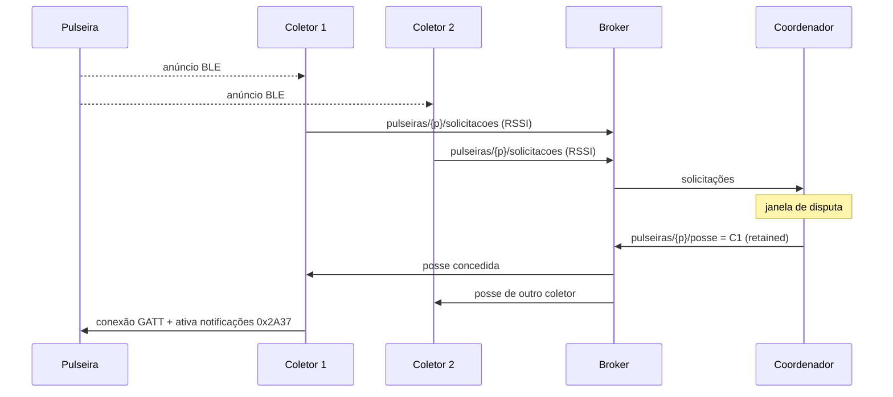

# Roteiro da documentação final — Projeto 13, Frente 3

> Guia para escrever a documentação de engenharia de software do gateway BLE (pulseiras Polar Verity Sense → coletores → broker MQTT → coordenador). Parte do princípio de que todos os requisitos estão implementados e em produção.
>
> Este arquivo **não é** a documentação. É o roteiro para produzi-la e pode ser apagado quando o documento final estiver pronto.

## Como usar este roteiro

- Cada seção corresponde a um capítulo do documento final e traz:
  - **Objetivo**: para que o capítulo serve.
  - **O que fazer**: passos em ordem.
  - **Fontes**: o que já existe no repositório e pode ser aproveitado.
  - **Modelo**: tabela ou trecho para copiar (quando houver).
  - **Pronto quando**: critério para considerar o capítulo concluído.
- Escreva no tempo verbal de um sistema entregue: "o coletor publica", "o tempo medido foi". Evite "deverá" e "será implementado", exceto nos requisitos, onde "deve" é a forma padrão.
- Todo número (limiar, timeout, latência) precisa ter fonte: código, `.env.example` ou medição. Sem fonte, meça ou marque como pendente.
- Normas de referência:
  - **arc42**: estrutura da documentação de arquitetura.
  - **Modelo C4**: diagramas de arquitetura.
  - **ISO/IEC/IEEE 29148**: requisitos.
  - **ISO/IEC/IEEE 29119-3**: documentação de testes.
  - **ISO/IEC 25010**: características de qualidade (categorias dos RNFs).
  - **ABNT NBR 6023**: referências bibliográficas.

## Onde escrever

Recomendação: **docs-as-code**. Markdown + Mermaid ou PlantUML no próprio repositório, versionados no Git junto com o código. O PDF oficial é gerado a partir desses arquivos (MkDocs com plugin de PDF, ou Pandoc).

Estrutura sugerida (`RFs/`, `RNFs/` e `images/` já existem e ficam onde estão):

```text
docs/
├── index.md                    # capítulos 0 e 1: controle e introdução
├── 02-fundamentacao.md
├── 03-requisitos.md            # processo, regras de negócio, restrições, rastreabilidade
├── RFs/                        # já existe
├── RNFs/                       # já existe
├── 04-arquitetura.md
├── adr/                        # uma decisão por arquivo: 0001-mqtt-como-canal-unico.md ...
├── 05-contrato-mensagens.md    # + asyncapi.yaml (opcional)
├── 06-comportamento.md
├── 07-implementacao.md
├── 08-testes/
│   ├── plano.md
│   ├── casos.md
│   └── resultados.md
├── 09-seguranca-privacidade.md
├── 10-operacao/
│   ├── instalacao.md
│   ├── runbook.md
│   └── manual-usuario.md
├── 11-encerramento.md
├── diagramas/                  # fontes .mmd / .puml
└── images/                     # já existe
```

## Ordem recomendada de escrita

Não escreva na ordem dos capítulos. Esta ordem evita retrabalho:

1. Resolver as [pendências](#pendências-a-resolver-antes-de-escrever) do fim deste arquivo.
2. Requisitos (cap. 3), com a matriz de rastreabilidade em rascunho.
3. Arquitetura e ADRs (cap. 4).
4. Contrato de mensagens (cap. 5).
5. Comportamento (cap. 6).
6. Implementação (cap. 7).
7. Testes (cap. 8), que completam a matriz de rastreabilidade.
8. Segurança (cap. 9) e Operação (cap. 10).
9. Fundamentação (cap. 2). Nesse ponto você já sabe quais conceitos o texto realmente usa.
10. Introdução (cap. 1), Encerramento (cap. 11) e Controle (cap. 0), por último.

---

## 0. Elementos de controle

**Objetivo:** quem pegar o documento sabe qual versão está lendo, quem responde por ele e onde achar cada coisa.

**O que fazer:**

1. Capa: nome do projeto, frente, laboratório (NB4/CNPEM), versão do documento, data, autores.
2. Tabela de histórico de versões. Cada alteração relevante vira uma linha.
3. Tabela de responsáveis: quem escreveu, quem revisou, quem aprovou (orientador ou coordenador do projeto no CNPEM).
4. Sumário, lista de figuras e lista de tabelas (geradas automaticamente pelo MkDocs ou Pandoc).
5. Lista de siglas: BLE, GAP, GATT, CCCD, RSSI, MQTT, QoS, LWT, PPG, RR, VFC/HRV, ADR, RF, RNF, RN, CT, NB4, LGPD, DPO.
6. Glossário: não duplique. Remeta a `docs/Linguagem-Ubiqua.md` e garanta que todos os termos usados no documento estejam lá, com a mesma grafia.

**Modelo:**

| Versão | Data | Autor | Alteração |
|---|---|---|---|
| 1.0 | AAAA-MM-DD | Nome | Versão de entrega |

**Pronto quando:**

- [ ] Todo termo de domínio usado no texto (pulseira, coletor ativo, coletor inativo, posse, handoff, consumidor...) está no glossário com a mesma grafia.
- [ ] A versão do documento corresponde a uma tag do repositório.

---

## 1. Introdução

**Objetivo:** explicar em 1 a 2 páginas por que o sistema existe, o que faz e o que não faz.

**O que fazer:**

1. **Contexto**: Projeto 13, Frente 3; monitoramento cardíaco e de estresse no NB4; papel desta frente (captura e transporte do dado fisiológico, não a análise).
2. **Problema**, em termos concretos: o pesquisador se desloca entre salas; o alcance do BLE é limitado; a pulseira aceita um central por vez e para de anunciar quando conectada. Por isso um único receptor fixo não cobre o laboratório.
3. **Objetivo geral** (uma frase) e **objetivos específicos** (OE1, OE2...), cada um verificável e ligado a pelo menos um RF.
4. **Escopo**: listas "dentro" e "fora". Seja explícito sobre o que pertence a outras frentes.
5. **Partes interessadas**: pesquisadores (usuários das pulseiras), equipe do laboratório, sistemas consumidores dos dados, equipe que vai operar, mantenedores do código.
6. **Público-alvo e como ler**: quem opera vai direto ao cap. 10; quem mantém o código lê os caps. 4 a 7.
7. **Visão geral em uma figura**: reaproveite o diagrama de contexto (C4 nível 1) do cap. 4.

**Fontes:** `docs/Projeto13.pdf`, `README.md`, `CLAUDE.md` (seção *Target design*).

**Pronto quando:**

- [ ] Alguém de fora do projeto entende o problema sem ler o resto.
- [ ] Cada objetivo específico aponta para pelo menos um RF.

---

## 2. Fundamentação teórica

**Objetivo:** dar a base necessária para entender as decisões. Não é revisão bibliográfica completa: cada conceito apresentado precisa ser usado em algum capítulo seguinte.

**O que fazer:**

1. Para cada tema, escreva a definição curta, o detalhe que importa para o projeto e a referência. Termine indicando onde o conceito é usado ("ver ADR-0003", "ver RF16").
2. Temas e o que precisa constar:

| Tema | O que precisa constar | Usado em |
|---|---|---|
| BLE: papéis, anúncio, conexão | Central × periférico; o anúncio para quando a pulseira conecta; um central por vez | Problema, ADR do handoff, RF18 |
| GAP e GATT | Serviço, característica, descritor, notificação (CCCD) | RF07, RF16 |
| Heart Rate Service (0x180D / 0x2A37) | Byte de flags; bpm em uint8 ou uint16; contato com a pele; intervalos RR em 1/1024 s | RF16, cap. 5 |
| Polar Verity Sense | Sensor PPG, modos de operação, autonomia de bateria, alcance declarado pelo fabricante | Restrições, cap. 10 |
| RSSI | dBm e escala logarítmica; multipercurso; o corpo como obstáculo; variabilidade; filtragem (média móvel, EMA); limiar com histerese | RF04, RF19, decisão de handoff |
| Pilha BLE no Linux | BlueZ, D-Bus, bleak; MAC no Linux × UUID no macOS; `btmgmt` para RSSI da conexão ativa | RNF01, RF04, cap. 10 |
| MQTT | Pub/sub, broker, tópicos e curingas (`+`, `#`), QoS 0/1/2, retained, Last Will, keepalive, sessão persistente | Cap. 5, RF09 a RF17 |
| Handoff | Origem nas redes celulares; hard × soft (break-before-make × make-before-break); histerese e efeito ping-pong | ADR do handoff, RNF04 |
| Coordenação distribuída | Coordenador central, ativo/reserva, detecção de falha, mandato/época (*fencing token*), *split-brain* | ADR de alta disponibilidade, RNF06 |
| Containers | Imagem, container, Compose; acesso a hardware (`network_mode: host`, `privileged`, socket do D-Bus) | RNF02, cap. 10 |
| VFC/HRV e estresse (opcional) | Por que os intervalos RR importam para quem consome os dados | Justificativa do RF16 |

3. Prefira fontes primárias: especificação Bluetooth Core e especificação do Heart Rate Service (Bluetooth SIG); especificação MQTT 3.1.1 ou 5.0 (OASIS); documentação do BlueZ, do bleak e da HiveMQ; documentação técnica da Polar.

**Fontes:** `docs/BLE_linux.md`, `docs/images/linux-bluetooth-architecture.jpg`, PDF de design em `docs/`.

**Pronto quando:**

- [ ] Todo conceito tem pelo menos uma referência.
- [ ] Nenhum conceito apresentado deixa de ser usado em outro capítulo.

---

## 3. Requisitos

**Objetivo:** registrar o que o sistema faz (RF) e com que qualidade (RNF), de forma verificável, e mostrar onde cada requisito foi atendido e testado.

**O que fazer:**

1. **Processo de levantamento**: como os requisitos surgiram (reuniões com quem, quando, documentos de origem).
2. **RFs (RF01 a RF20)**: o formato atual (descrição, caso de uso, história de usuário, critérios de aceitação) está adequado. Acrescente a cada um:
   - prioridade (MoSCoW: *Must*, *Should*, *Could*, *Won't*);
   - dependências (ex.: RF14 depende de RF11 e RF18);
   - status final (implementado, parcial, não implementado) e versão em que entrou;
   - módulo que o implementa (caminho no código).
3. **RNFs (RNF01 a RNF12)**: para cada um,
   - categoria segundo a ISO/IEC 25010 (adequação funcional, eficiência de desempenho, compatibilidade, usabilidade, confiabilidade, segurança, manutenibilidade, portabilidade);
   - métrica, valor-alvo e método de verificação. **Um RNF sem número não pode ser verificado**;
   - valor medido (preenchido no cap. 8).
4. **Regras de negócio** numeradas (RN01, RN02...). Exemplos a confirmar no código:
   - uma pulseira tem no máximo um coletor com posse;
   - vence a solicitação de maior RSSI dentro da janela de disputa;
   - critério de desempate;
   - leituras com bpm igual a 0 são descartadas.
5. **Restrições** (impostas, não escolhidas): ambiente NB4, rede apenas local (RNF03), Raspberry Pi (RNF01), sensor Polar.
6. **Premissas** (o que se assume verdadeiro): ex.: há cobertura de rádio entre salas vizinhas; a pulseira está carregada no início do turno.
7. **Diagrama de casos de uso** com os atores Pesquisador, Coletor BLE, Coordenador e Consumidor.
8. **Matriz de rastreabilidade**: comece aqui com as colunas de requisito e objetivo; complete nos caps. 7 e 8.

**Modelo — RNF verificável:**

| Campo | Descrição |
|---|---|
| Identificador | RNF04 |
| Nome | Tempo de *handoff* |
| Categoria (ISO 25010) | Eficiência de desempenho — comportamento temporal |
| Descrição | O intervalo sem dados de frequência cardíaca durante um *handoff* deve ser de no máximo X s. |
| Métrica | Tempo entre a última leitura publicada pelo coletor de origem e a primeira publicada pelo coletor de destino |
| Valor-alvo | ≤ X s em 95% dos *handoffs* |
| Método de verificação | Caso de teste CT-06.1, N repetições |
| Valor medido | (preencher no cap. 8) |

**Modelo — matriz de rastreabilidade:**

| Requisito | Objetivo | Módulo / arquivo | Caso(s) de teste | Evidência | Status |
|---|---|---|---|---|---|
| RF05 | OE2 | `src/gateway/bluetooth/reconexao.py` | CT-05.1, CT-05.2 | `tests/test_reconexao.py`, log de campo | Atendido |

**Fontes:** `docs/RFs/`, `docs/RNFs/`.

**Pronto quando:**

- [ ] Todo RNF tem categoria correta, métrica, valor-alvo e valor medido.
- [ ] Nenhuma linha da matriz fica sem caso de teste.
- [ ] O identificador no nome do arquivo e no título é o mesmo.

---

## 4. Arquitetura

**Objetivo:** mostrar a estrutura do sistema em níveis crescentes de detalhe e justificar as escolhas.

**O que fazer:**

1. **Estilo arquitetural**, em um parágrafo: orientado a eventos, comunicação exclusivamente pelo broker MQTT, coordenação central da posse.
2. **Diagramas C4**, cada um com um parágrafo de explicação abaixo:
   - **Nível 1 — Contexto**: pessoas e sistemas externos (pesquisador com pulseira, sistema consumidor, dashboard, equipe de operação).
   - **Nível 2 — Contêineres**: serviço coletor (em cada Raspberry Pi), coordenador ativo e reserva, broker HiveMQ, dashboard. Indique o protocolo em cada seta (BLE/GATT, MQTT, HTTP).
   - **Nível 3 — Componentes**:
     - coletor: `bluetooth/` (`scanner`, `conexao`, `reconexao`, `domain/`) e `mqtt/` (`conexao`, `presenca`, `estado_rssi`, `domain/topicos`);
     - coordenador: `coordenador/` (`coordenador`, `visao`).
3. **Diagrama de implantação**: planta ou esquema das salas do NB4 com a posição dos 5 coletores, as máquinas centrais, a rede local, o IP virtual e o mapa de vizinhança entre coletores.
4. **Modelo de domínio** (diagrama de classes): Pulseira, Coletor, Coordenador, Posse, Leitura de FC, Estado da conexão, com multiplicidades (uma pulseira tem zero ou um coletor com posse).
5. **Stack**: tabela com tecnologia, versão exata e função (Python 3.11, bleak, cliente MQTT, HiveMQ 4.x, Docker, sistema operacional do Raspberry Pi, BlueZ).
6. **Decisões arquiteturais (ADRs)**: um arquivo por decisão em `docs/adr/`, numerado e imutável. Uma decisão revista ganha um ADR novo que substitui o anterior. Decisões que precisam constar:
   - ADR-0001: MQTT como único canal de rede, em vez do link TCP ponto a ponto previsto no PDF de design original.
   - ADR-0002: coordenador central decide a posse, em vez de os coletores negociarem entre si.
   - ADR-0003: handoff "soltar e disputar", em vez de *make-before-break*; aceita o intervalo sem dados.
   - ADR-0004: classificação `conexao-fraca` feita no coordenador, e não no coletor.
   - ADR-0005: alta disponibilidade com coordenador ativo/reserva e IP virtual; Redis descartado.
   - ADR-0006: HiveMQ auto-hospedado em Docker, sem serviço em nuvem.
   - ADR-0007: Python + bleak.
   - ADR-0008: onde o Docker é usado na implantação (ver pendências).

**Modelo — ADR:**

```markdown
# ADR-0003: Handoff "soltar e disputar"

- Status: Aceita | Substituída por ADR-00xx
- Data: AAAA-MM-DD
- Decisores: nomes

## Contexto
O problema e as restrições (um central por vez, o anúncio cessa durante a conexão...).

## Opções consideradas
1. Make-before-break (exige conexão dupla; foi testado? qual o resultado?)
2. Coletores negociando a posse entre si
3. Soltar e disputar

## Decisão
A opção escolhida e o porquê.

## Consequências
Positivas; negativas (intervalo sem dados); o que passou a ser necessário
(janela de disputa, mapa de vizinhança, fallback para o dono original).
```

**Fontes:** `docs/arquitetura.png`, PDF de design em `docs/` (para registrar o que mudou em relação a ele), histórico de commits.

**Pronto quando:**

- [ ] Os nomes nos diagramas são os mesmos do código e do glossário.
- [ ] Toda divergência em relação ao PDF de design original é explicada por um ADR.

---

## 5. Contrato de mensagens

**Objetivo:** especificar a interface entre coletores, coordenador e consumidores com precisão suficiente para que alguém escreva um novo cliente sem ler o código. Atende ao RF15.

**O que fazer:**

1. **Árvore de tópicos** e convenção de nomes (minúsculas, hífen, identificadores no meio do caminho). Tópicos atuais, de `src/gateway/mqtt/domain/topicos.py`:

   ```text
   coletores/{coletor}/presenca                # coletor: presença e sinal de vida
   coletores/{coletor}/pulseiras/{pulseira}    # coletor: estado e RSSI por pulseira
   coordenador/presenca                        # coordenador: presença e sinal de vida
   pulseiras/{pulseira}/solicitacoes           # coletor: solicitação e liberação de posse
   pulseiras/{pulseira}/posse                  # coordenador: dono atual ou posse liberada
   pulseiras/{pulseira}/handoff                # coordenador: comando de handoff (origem, destino)
   pulseiras/{pulseira}/frequencia-cardiaca    # coletor ativo: leituras de FC
   ```

2. **Formato dos identificadores**: `{coletor}` (UUID, ver `COLETOR_ID` no `.env.example`?) e `{pulseira}` (MAC? com ou sem `:`? maiúsculas?).
3. **Uma tabela por tópico** (ver modelo) e um exemplo real de payload, copiado de uma captura do broker em produção.
4. **JSON Schema de cada payload**: tipos, obrigatoriedade, unidades, faixa de valores.
5. **Timestamp padronizado**: ISO 8601 em UTC ou epoch em ms. Escolha um e use em todas as mensagens.
6. **Last Will de cada cliente**: tópico, payload, QoS, retained.
7. **Versionamento do contrato**: campo `versao` no payload ou prefixo `v1/` no tópico; defina o que conta como mudança incompatível.
8. Opcional, recomendado: `docs/asyncapi.yaml` com a especificação **AsyncAPI** (o equivalente do OpenAPI para sistemas orientados a eventos). Gera documentação navegável e serve de contrato formal.

**Modelo — por tópico** (preencha QoS e retained a partir do código, não deste modelo):

| Campo | Valor |
|---|---|
| Tópico | `pulseiras/{pulseira}/posse` |
| Produtor | Coordenador ativo |
| Consumidores | Coletores, dashboard |
| QoS | |
| Retained | |
| Quando é publicado | Concessão, liberação e troca de posse |
| Last Will | |
| Schema | link para o JSON Schema |
| Exemplo | bloco JSON real |

**Pronto quando:**

- [ ] Todo tópico usado no código está documentado, e todo tópico documentado existe no código.
- [ ] Cada exemplo de payload valida contra o seu schema.

---

## 6. Comportamento: fluxos e diagramas

**Objetivo:** mostrar como o sistema se comporta ao longo do tempo, principalmente nos cenários de falha.

**O que fazer:**

1. **Máquinas de estados** (UML de estados), com o evento que dispara cada transição:
   - coletor, por pulseira: use os estados do RF08 (`conectado`, `desconectado`, `nao-encontrado`) mais os estados internos de varredura, conexão e liberação;
   - posse, no coordenador: livre → em disputa → concedida → em handoff → concedida ou liberada.
2. **Diagramas de sequência**, um por cenário. Mensagens MQTT com o tópico real; operações BLE com o nome GATT:
   1. Inicialização do coletor: conexão ao broker, registro do Last Will, anúncio de presença.
   2. Primeira posse: anúncio detectado, solicitações, janela de disputa, concessão, conexão GATT.
   3. Leitura de FC: notificação 0x2A37, decodificação, descarte de bpm igual a 0, publicação.
   4. Handoff no caminho feliz: queda do RSSI, liberação, janela de varredura dos vizinhos, disputa, nova concessão.
   5. Handoff com fallback: nenhum vizinho vê a pulseira e a posse volta ao dono original.
   6. Reconexão BLE automática (RF05).
   7. Queda de um coletor: Last Will publicado, coordenador libera as posses dele.
   8. Queda do coordenador ativo: o reserva detecta, assume o mandato e reconstrói a visão a partir dos coletores.
3. **Fluxograma da decisão de handoff**: entradas (RSSI filtrado, leituras consecutivas abaixo do limiar, mapa de vizinhança), decisões e saídas.
4. **Tabela de temporizadores e limiares**: todo número que muda o comportamento do sistema.

**Modelo — sequência em Mermaid** (adapte aos payloads reais):



**Modelo — tabela de parâmetros** (ponto de partida: `.env.example`):

| Parâmetro | Padrão | Unidade | Componente | Efeito |
|---|---|---|---|---|
| `SCAN_TIMEOUT` | 10 | s | Coletor | Duração da varredura BLE |
| `CONNECT_TIMEOUT` | 20 | s | Coletor | Tempo máximo para conectar à pulseira |
| `RSSI_INTERVALO` | 1 | s | Coletor | Período de leitura do RSSI |
| `PRESENCA_INTERVALO_COLETOR` | 5.0 | s | Coletor | Período do sinal de vida |
| `PRESENCA_INTERVALO_COORDENADOR` | 5.0 | s | Coordenador | Período do sinal de vida |
| `BROKER_INTERVALO_RECONEXAO` | 5 | s | Ambos | Espera entre tentativas de reconexão ao broker |
| ... | | | | Janela de disputa, limiar de conexão fraca, leituras consecutivas, janela de varredura dos vizinhos... |

**Pronto quando:**

- [ ] Todo cenário de falha previsto no RNF06 tem diagrama de sequência.
- [ ] Todo parâmetro da tabela existe no código ou na configuração com o mesmo nome e o mesmo valor padrão.

---

## 7. Implementação

**Objetivo:** um novo desenvolvedor entende o código e contribui sem quebrar convenções.

**O que fazer:**

1. **Estrutura de pastas**, com a responsabilidade de cada módulo (uma linha por arquivo).
2. **Convenções de código**: PEP 8; identificadores, comentários, logs e commits em português; type hints; `asyncio`. Registre a decisão tomada sobre `docs/proposta-migracao-ingles.md`.
3. **Importações**: explique por que `bluetooth` é importado como módulo de nível superior (`sys.path` em `main.py` e `PYTHONPATH` no `Dockerfile`).
4. **Tratamento de erros**: hierarquia de exceções de `bluetooth/domain/erros.py`, quando cada uma é lançada e como é tratada.
5. **Configuração**: tabela completa de variáveis de ambiente (nome, obrigatória, padrão, descrição, componente). Para achar todas: `grep -rn "getenv\|environ" src/`. Sinalize as que nunca vão para o Git (ex.: `BROKER_SENHA`).
6. **Logs**: formato, níveis, destino, como coletar de um container (RNF10).
7. **Fluxo de trabalho Git**: `main` protegida, branches `feature/*`, PR com revisão, padrão de commit (`feat:`, `fix:`...), versionamento semântico e tags de release.
8. **Dependências**: versão fixada de cada pacote e sua licença; licença do projeto (`LICENSE`).
9. **Como estender**: passo a passo para adicionar um tipo de mensagem, um coletor e um tipo de sensor.

**Fontes:** `src/`, `requirements.txt`, `Dockerfile`, `docker-compose.yml`, `.env.example`, `CLAUDE.md`, histórico do Git.

**Pronto quando:**

- [ ] A tabela de variáveis de ambiente cobre tudo o que o código lê do ambiente.
- [ ] Um desenvolvedor novo consegue rodar o projeto lendo só este capítulo.

---

## 8. Qualidade e testes

**Objetivo:** provar, com evidência, que cada requisito foi atendido. Num projeto entregue, é este capítulo que sustenta o termo de aceite.

**O que fazer:**

1. **Plano de testes**: estratégia por nível, o que cada nível cobre e o que não cobre.

   | Nível | O que testa | Como | Requisitos |
   |---|---|---|---|
   | Unitário | Lógica isolada: reconexão, extração de tópicos, decisão de posse, decodificação de 0x2A37 | pytest, sem hardware, com dublês de bleak e MQTT | RF05, RF14, RF15, RF16, RF19 |
   | Integração | Coletor e coordenador trocando mensagens | Broker real em container, pulseira simulada | RF09 a RF15, RF17 |
   | Sistema | Fluxo completo com pulseiras reais | Bancada com 2 ou mais coletores | RF01 a RF20 |
   | Campo | Deslocamento real entre salas | NB4, percurso definido e repetido | RF06, RNF04, RNF05 |
   | Desempenho | Tempo de handoff, latência ponta a ponta | Timestamps nas mensagens | RNF04, RNF05 |
   | Resiliência | Derrubar coletor, broker e coordenador; desligar a pulseira | Roteiro de falhas | RNF06 |
   | Recursos | CPU, memória e temperatura no Raspberry Pi | `docker stats`, `top`, por N horas | RNF07 |
   | Segurança | Acesso sem credencial, publicação em tópico proibido | Cliente MQTT de teste | RNF08 |
   | Longa duração | Estabilidade | 8 h a 24 h contínuas | RNF06, RNF07 |

2. **Ambiente de teste**: hardware (modelos e quantidades), versões de software, topologia, firmware das pulseiras.
3. **Casos de teste**: um por critério de aceitação relevante (ver modelo). O identificador remete ao requisito: CT-06.1 testa o RF06.
4. **Resultados**:
   - tabela de execução: data, versão testada (commit ou tag), resultado, evidência;
   - para os RNFs, estatística: n, média, mediana, p95, máximo;
   - gráficos: histograma do tempo de handoff; série temporal do RSSI durante um percurso, com o momento do handoff marcado.
5. Se os testes de desempenho e de campo não foram registrados na época, **refaça-os agora** na versão em produção. Não reconstrua resultados de memória.
6. **Cobertura de código** dos testes unitários (`pytest --cov`, requer `pytest-cov`), com a ressalva de que o BLE real não é coberto por testes unitários.
7. **Defeitos**: os relevantes encontrados, causa, correção e commit.
8. **Critérios de aceite**: o que precisou ser verdade para a entrega e quem homologou.
9. Feche a matriz de rastreabilidade do cap. 3.

**Modelo — caso de teste:**

| Campo | Valor |
|---|---|
| ID | CT-06.1 |
| Requisitos | RF06, RNF04 |
| Objetivo | Verificar o handoff entre coletores vizinhos com o pesquisador andando |
| Pré-condições | Coletores 1 e 2 vizinhos no mapa; coordenador ativo; pulseira com posse no coletor 1 |
| Passos | 1. O pesquisador parte da sala A... 2. ... |
| Resultado esperado | A posse passa ao coletor 2; intervalo sem dados ≤ X s |
| Resultado obtido | |
| Status | Passou / Falhou |
| Evidência | Log, captura do broker, vídeo, commit testado |

**Fontes:** `tests/test_reconexao.py`, rotinas de diagnóstico em `src/gateway/main.py`, logs de produção.

**Pronto quando:**

- [ ] Todo requisito tem pelo menos um caso de teste executado, com evidência.
- [ ] Todo RNF tem valor medido comparado ao valor-alvo.
- [ ] As falhas conhecidas estão registradas, não omitidas.

---

## 9. Segurança e privacidade

**Objetivo:** mostrar que o dado fisiológico é tratado de acordo com a LGPD e que o sistema resiste às ameaças plausíveis no ambiente.

**O que fazer:**

1. **Classificação do dado**: frequência cardíaca é dado pessoal sensível (dado referente à saúde, LGPD art. 5º, II), com regras próprias de tratamento (art. 11).
2. **Com o encarregado de dados (DPO) do CNPEM**, definir e registrar: base legal, termo de consentimento dos pesquisadores, finalidade, tempo de retenção e descarte. Registre as respostas por escrito, não presuma.
3. **Pseudonimização**: o sistema trafega o identificador da pulseira, não o nome da pessoa. Documente onde fica o vínculo pulseira → pessoa e quem tem acesso a ele.
4. Verificar com o CNPEM se a coleta exige aprovação de **Comitê de Ética em Pesquisa** (pesquisa com seres humanos).
5. **Modelo de ameaças (STRIDE)** em tabela: ameaça, componente, impacto, controle existente, risco residual. No mínimo:
   - escuta do tráfego BLE;
   - cliente MQTT não autorizado;
   - coletor falso solicitando posse;
   - publicação falsa de frequência cardíaca;
   - negação de serviço no broker;
   - acesso físico a um Raspberry Pi.
6. **Controles implementados**: autenticação no broker, ACL por tópico, TLS (se houver), rede isolada sem internet (RNF03), segredos fora do Git, política de atualização do sistema operacional.

**Pronto quando:**

- [ ] Base legal e retenção confirmadas por escrito pelo responsável do CNPEM.
- [ ] Cada ameaça tem um controle ou a aceitação explícita do risco.

---

## 10. Implantação e operação

**Objetivo:** a equipe do laboratório instala, opera e recupera o sistema sem depender dos desenvolvedores.

**O que fazer:**

1. **Requisitos de hardware e software**: modelo do Raspberry Pi, cartão SD, sistema operacional e versão, versão do BlueZ, Docker, rede.
2. **Instalação passo a passo**, testada por alguém que não escreveu o sistema:
   - broker HiveMQ;
   - coordenador ativo e reserva, com o IP virtual;
   - novo coletor, do cartão SD vazio até aparecer no dashboard (inclui `start.sh` e `docker compose`).
3. **Mapa de vizinhança**: formato, onde fica, como alterar quando um coletor muda de lugar.
4. **Inventário**: coletores (identificador, sala, IP, endereço do adaptador) e pulseiras (identificador, MAC). Sem nomes de pesquisadores (ver cap. 9).
5. **Monitoramento**: o que observar no dashboard (RF20) e no console da HiveMQ; como ler os logs de cada componente.
6. **Runbook** (ver modelo): um problema por linha, a partir dos problemas reais encontrados em produção.
7. **Procedimentos**: atualização de versão (um coletor por vez), rollback, backup do que precisa ser preservado, inclusão e remoção de coletor ou pulseira, troca manual do coordenador ativo para manutenção.
8. **Manual do usuário final** (pesquisador), em linguagem não técnica: como carregar, ligar e usar a pulseira; o que fazer se o dashboard não mostrar os dados; cuidados específicos do NB4.

**Modelo — runbook:**

| Sintoma | Causa provável | Como confirmar | Ação |
|---|---|---|---|
| Pulseira não aparece no dashboard | Pulseira descarregada ou fora de alcance | Estado `nao-encontrado` em todos os coletores | Carregar ou ligar a pulseira |
| RSSI da conexão indisponível | Índice do adaptador ou tipo de endereço diferente do configurado no `btmgmt` | `btmgmt conn-info` responde "Not Connected" | Ajustar a configuração do adaptador |
| Coordenador reserva não assumiu | | | |

**Fontes:** `README.md`, `docs/BLE_linux.md`, `start.sh`, `Dockerfile`, `docker-compose.yml`.

**Pronto quando:**

- [ ] Uma pessoa que não participou do projeto instalou um coletor seguindo só o documento.
- [ ] O runbook cobre todos os incidentes registrados em produção.

---

## 11. Encerramento

**Objetivo:** registrar o estado final, o que ficou pendente e quem responde pelo sistema daqui em diante.

**O que fazer:**

1. **Limitações conhecidas**, com impacto e contorno: intervalo sem dados durante o handoff, ruído do RSSI, conexões simultâneas por adaptador, dependência de uma única rede, comportamento se o broker cair.
2. **Dívida técnica**: o que foi feito de forma provisória e por quê.
3. **Trabalhos futuros**: melhorias identificadas, em ordem de valor.
4. **Lições aprendidas**: o que funcionou, o que não funcionou, o que faria diferente (ex.: a troca do TCP ponto a ponto pelo MQTT).
5. **Gestão do projeto**: equipe e papéis, metodologia, cronograma previsto × realizado, riscos que se concretizaram.
6. **Termo de aceite**: quem recebeu, quando e com quais ressalvas.
7. **Responsáveis pela manutenção** e contatos (por função, não só por nome).
8. **Referências** no padrão ABNT NBR 6023.
9. **Anexos**: RFs e RNFs completos, JSON Schemas ou AsyncAPI, arquivos de configuração de exemplo, modelo do termo de consentimento.

**Pronto quando:**

- [ ] Toda limitação tem o impacto descrito.
- [ ] Há um responsável nomeado pela manutenção.

---

## Diagramas: lista de verificação

| # | Diagrama | Notação | Capítulo | Feito |
|---|---|---|---|---|
| D1 | Contexto | C4 nível 1 | 1, 4 | [ ] |
| D2 | Contêineres | C4 nível 2 | 4 | [ ] |
| D3 | Componentes do coletor e do coordenador | C4 nível 3 | 4 | [ ] |
| D4 | Implantação física | UML de implantação ou planta | 4, 10 | [ ] |
| D5 | Modelo de domínio | UML de classes | 4 | [ ] |
| D6 | Casos de uso | UML de casos de uso | 3 | [ ] |
| D7 | Estados do coletor por pulseira | UML de estados | 6 | [ ] |
| D8 | Estados da posse | UML de estados | 6 | [ ] |
| D9 a D16 | Sequências 1 a 8 | UML de sequência | 6 | [ ] |
| D17 | Decisão de handoff | Fluxograma | 6 | [ ] |
| D18 | Árvore de tópicos | Árvore ou tabela | 5 | [ ] |

Regras para todos os diagramas:

- Fonte versionada em `docs/diagramas/` (Mermaid ou PlantUML). Para C4, use C4-PlantUML ou Structurizr.
- Título numerado ("Figura N — ...") e um parágrafo de explicação.
- Os mesmos nomes do glossário e do código.

---

## Pendências a resolver antes de escrever

- [ ] **Numeração dos RNFs**: `RNF09.md` tem o título "RNF9", `RNF11.md` está como "RNF12" e `RNF12.md` como "RNF13". Alinhar arquivo e título, senão a matriz de rastreabilidade não fecha.
- [ ] **RNF04**: está na categoria "Portabilidade"; o correto é "Eficiência de desempenho". O texto diz só "rapidamente", sem métrica. Revisar todos os RNFs com o modelo do cap. 3.
- [ ] **RNF02 × implantação real**: o RNF02 diz que o coletor é implantado via Docker, mas houve a intenção de usar Docker só na máquina do coordenador e do broker. Registrar o que está em produção (ADR-0008) e ajustar o RNF.
- [ ] **Onde roda o coordenador**: o glossário diz Raspberry Pi; o desenho de alta disponibilidade prevê máquinas centrais com broker + coordenador. Confirmar e alinhar glossário, RNF01 e diagrama de implantação.
- [ ] **Presença do coordenador**: `coordenador/presenca` não tem identificador porque o código assume um único coordenador. Com ativo e reserva, o contrato precisa distinguir os dois.
